# 润泽说 蒙学之千字文

> 一千字，三十三课；依句意分课，不硬拆五十课。
>
> 先读原文，再看字源，最后对一句。每课末附“AI形象字 · 全课”，把本课原文逐字铺成一面字墙。蒙学不是把字灌进孩子，是把人领到字面前。

## 第一课　天地玄黄

> 天与地，先于人来。

**原文**：天地玄黄，宇宙洪荒。日月盈昃，辰宿列张。

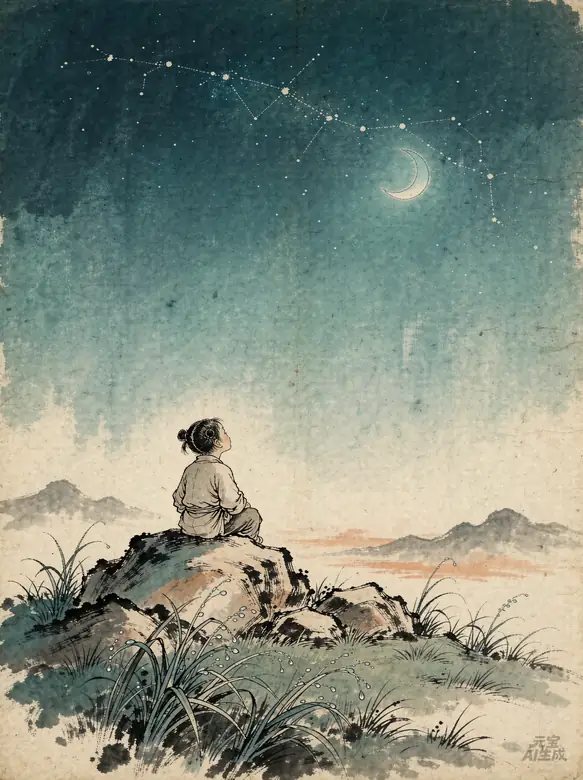

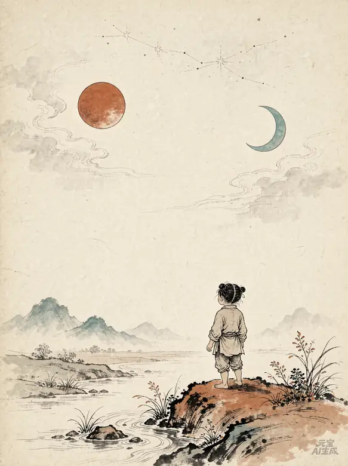

### 字源

- **天**：头顶之上：甲骨文、金文在“大”（人形）上加一横，指人头顶之上；本义为头顶，引申为天空。
- **地**：大地：从土、也声；本义为大地。土是能生养万物的那一层。
- **玄**：幽远：本义为幽远；黑中带赤为玄色。这里不是“神秘”，是天色深。
- **黄**：土色：本义为土地之色。甲骨文构形有异说，这里取“土黄”这一层。
- **宇**：屋檐：从宀、于声；本义为屋檐，引申为上下四方的空间。
- **宙**：久远：从宀、由声。《说文》释为“舟舆所极覆也”，后借为往古来今；这里取时间义。

### 直译与深解

天是深远的玄色，地是厚重的黄色。上下四方叫宇，往古来今叫宙。

太阳有圆有缺，月亮有盈有亏；星辰各就各位，铺列在天上。

《千字文》开篇不先讲人，先给天地和时空。孩子要先知道自己站在多大的一个场里：头上是天，脚下是地，前后左右是空间，过去未来是时间。

玄黄不是两种漂亮的颜色，是天地最基本的底色。日月盈昃，是把天看成有节律的：太阳升到中天，又向西斜；月亮圆了又缺。辰宿列张，是星星各有各的位置，不乱。

这一课不讲“宇宙大爆炸”，也不讲“天有多少层”。只讲一件事：人不是凭空来的，人一出生就在天地之间、昼夜之间。寒来暑往、秋收冬藏，下一课再落到身体上。

### 对课

- 天 — 地
- 日 — 月
- 玄 — 黄
- 宇 — 宙
- 盈 — 昃

> 二字一顿，四字一联；先读成对，再试一句。

### 生活场景

傍晚带孩子到阳台，看天从蓝变深，再看第一颗星出来。问他：“天是慢慢黑下来的，还是忽然黑的？”

### 亲子问

如果天没有边，我们的眼睛为什么能看到“天边”？

### 写字

天　玄

### AI形象字 · 全课

全课字墙：天、地、玄、黄、宇、宙、洪、荒、日、月、盈、昃、辰、宿、列、张。

AI形象字 · 全课 看这一课：天是站定的人，头顶加一横；地是厚土，承载万物；玄是天色深，黄是土色厚。宇是屋檐，宙是久远；洪是大水，荒是远草。日画圆，月画弯，盈是满，昃是斜；辰是星，宿是位，列是排，张是展开。十六个字，不是十六个符号，是十六眼：先看天，再看地；先看时间，再看空间。孩子读一遍，等于用古人的眼睛，把天地重新看一遍。

### 跨典

《道德经》第二十五章：“人法地，地法天，天法道，道法自然。”

---

## 第二课　秋收冬藏

> 时间不是钟表，是收成与闰月。

**原文**：寒来暑往，秋收冬藏。闰余成岁，律吕调阳。云腾致雨，露结为霜。

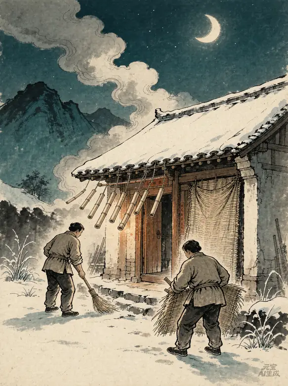

### 字源

- **秋**：谷物成熟：从禾，谷物成熟为秋；甲骨文另有象蟋蟀的写法，借指秋。
- **藏**：收存：本义为把谷物收存起来。收是往家收，藏是往深处放。
- **闰**：历法余分：本义为历法中的余分；余日积够，置闰成月。
- **律**：法则、律管：从彳、聿声；本义为法则，也指定音的律管。
- **阳**：山南水北：从阜、昜声；山南水北为阳，引申为阳气。

### 直译与深解

秋天收割，冬天收藏。一年有余日，攒够了就置一个闰月，年岁才合得上。

律吕调和阴阳，使节气与音律各归其位。

上一课讲天地有多大，这一课讲时间怎么被安排。秋收冬藏，是农事节律：该收就收，该藏就藏。闰余成岁，是历法修补：一年不是整数，古人不用“差不多”，要把它对齐。

律吕调阳，是音律与节气相应：不是附会，是古人把“时”看成一个整体。寒来暑往，是把时间落到身体上：一件衣服穿不住，又该换一件。

这四句教孩子一个很实在的本事：看见变化背后的节律。

### 对课

- 寒 — 暑
- 来 — 往
- 秋 — 冬
- 收 — 藏
- 律 — 吕

> 二字一顿，四字一联；先读成对，再试一句。

### 生活场景

翻一页日历，找到“闰”字；或者记一次换季：哪一天开始加衣、减衣？问孩子：“为什么一年要多出一天，还要专门给它起个名字？”

### 亲子问

如果一年不是整数，古人为什么一定要把它对齐，而不是说“差不多就行”？

### 写字

秋　藏

### AI形象字 · 全课

全课字墙：寒、来、暑、往、秋、收、冬、藏、闰、余、成、岁、律、吕、调、阳、云、腾、致、雨、露、结、为、霜。

AI形象字 · 全课 看这一课：寒是屋下的冰草，来是麦穗，暑是日下的热气，往是一只脚走开；秋是一只虫，收是一只手把庄稼拢回来，冬是一根打了结的绳，藏是把收成塞进屋。闰是门里多出的日子，余是剩下的一口粮；成是一把斧头把事做定，岁是一把镰刀走过一季；律是手执笔管，吕是两块脊椎骨，调是把话说回中间，阳是山南的太阳。云是天上回旋的气，腾是马上升，致是送到，雨是从天落水；露是草叶上的水，结是丝绳打结，为是手牵着做，霜是草上结白。二十四个字，把一年的冷暖、收成、历法、音律、云雨霜，全串起来了。

### 跨典

《易传·系辞下》：“寒往则暑来，暑往则寒来，寒暑相推，而岁成焉。”

---

## 第三课　金生丽水

> 物有出处，名有其实；从金玉到菜蔬。

**原文**：金生丽水，玉出昆冈。剑号巨阙，珠称夜光。果珍李柰，菜重芥姜。

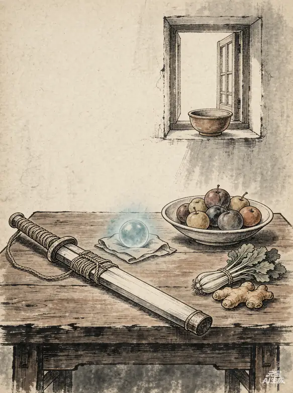

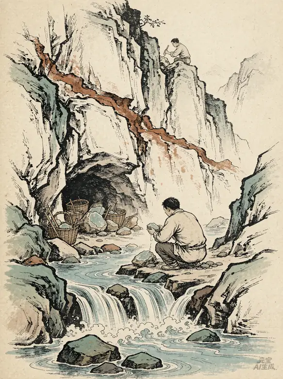

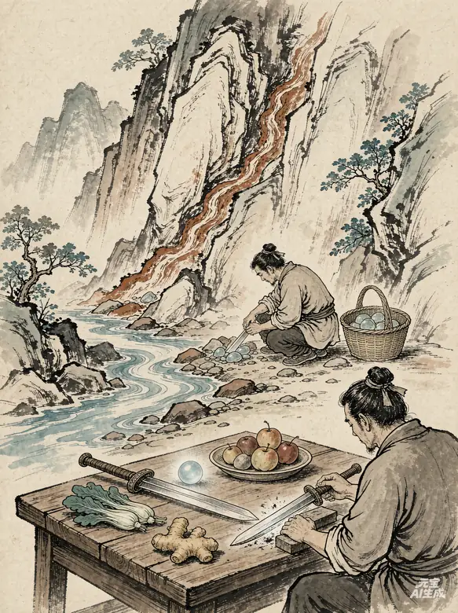

### 字源

- **金**：金属总名：《说文》说“五色金也”。古人把金、银、铜、铁等，都归在“金”这一类。
- **玉**：美石：象形，像一串玉；本义为美石。玉不是普通石头，是被人看重、被人磨过的石头。
- **剑**：双刃兵器：从佥声，本义为双刃兵器。剑有双刃，刀有单刃，这是形制之别。
- **珠**：珍珠：从玉、朱声；本义为珍珠。珠在蚌中长成，不是一开始就圆。
- **柰**：古果名：古果名，类似今天的沙果、花红。李柰并称，是古人的日常果子。

### 直译与深解

金出在丽水，玉出在昆仑山。名剑叫巨阙，名珠叫夜光。果子里的珍品，是李子和柰；菜里看重的，是芥菜和生姜。

这一课讲“物产”和“名物”。金从水里来，玉从山上来；剑有巨阙，珠有夜光；果有李柰，菜有芥姜。每一件好东西都有出处，不是凭空掉下来的。

但这一课不只是认宝贝。它还在教孩子一件事：物有名，名有实。一把剑叫“巨阙”，不是因为名字好听，是因为它真能断物；一颗珠叫“夜光”，不是因为传说神，是因为它曾被看见发光。菜重芥姜，是把日常滋味也放进“物”里；不是只有金玉剑珠才值得记。

名是入口，实是根本。若只记名字，不认东西，名就空了。

### 对课

- 金 — 玉
- 剑 — 珠
- 果 — 菜
- 李 — 柰
- 芥 — 姜

> 二字一顿，四字一联；先读成对，再试一句。

### 生活场景

给孩子一块石头、一枚硬币、一把小刀，让他摸一摸冷热和轻重。问：“贵的东西，一定有用吗？”

### 亲子问

如果一把剑很名贵，却从来没有保护过人，它还算“名剑”吗？

### 写字

玉　金

### AI形象字 · 全课

全课字墙：金、生、丽、水、玉、出、昆、冈、剑、号、巨、阙、珠、称、夜、光、果、珍、李、柰、菜、重、芥、姜。

AI形象字 · 全课 看这一课：金是器里藏着的砂，生是地上冒出的芽，丽是两只鹿角并排，水是三条水流；玉是三块玉串绳，出是一只脚走出坑，昆是日下两个人，冈是山脊上的一张网。剑是刀，号是口，巨是张开的尺，阙是门；珠是玉珠，称是手称禾，夜是人入夕，光是火照人。果是树上结果，珍是玉上有纹，李是木旁有子，柰是木上结子；菜是草，重是人负物，芥是草间人，姜是草下羊。二十四个字，从金玉剑珠，走到果菜姜，物有名，也有来处。

### 跨典

《道德经》第九章：“金玉满堂，莫之能守。”

---

## 第四课　海咸河淡

> 从水味、鱼鸟，到初民的名。

**原文**：海咸河淡，鳞潜羽翔。龙师火帝，鸟官人皇。

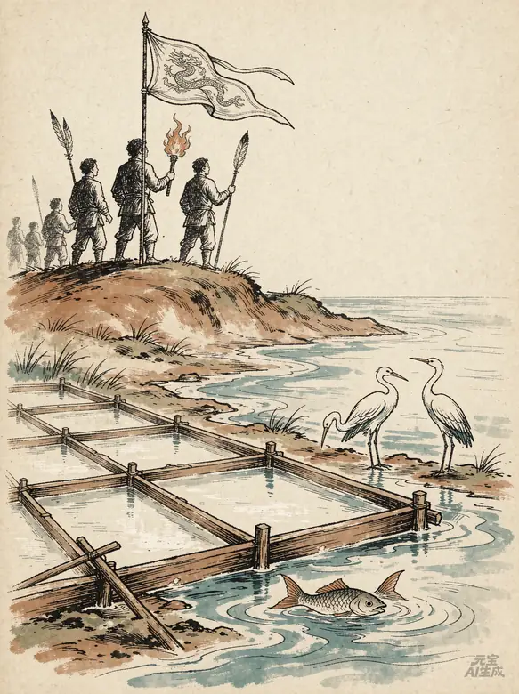

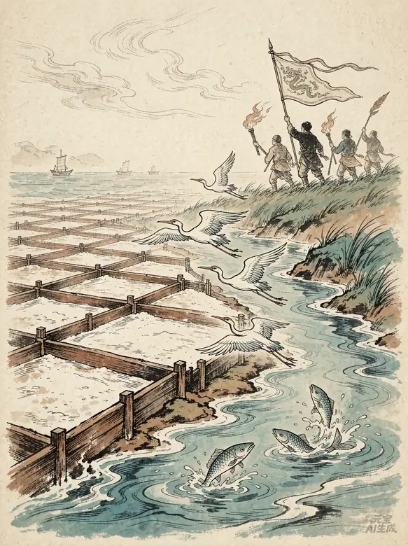

### 字源

- **海**：大海：从水、每声；本义为大海。海是众水所归，也是古人视野的尽头。
- **咸**：盐味：此处指盐味。“咸”另有“皆、都”义，两个字义要分开。
- **鳞**：鱼鳞：从鱼、粦声；本义为鱼鳞。这里用“鳞”代鱼，是借部分指整体。
- **潜**：没入水中：从水，本义为没入水中。鱼在水下，不是消失，是换了可见的方式。
- **翔**：盘旋而飞：从羽、羊声；本义为盘旋而飞。翔不是直线冲刺，是在空中回旋。

### 直译与深解

海水是咸的，河水是淡的。鱼在水里潜游，鸟在天上盘旋。

伏羲以龙名官，神农以火名官；少昊以鸟名官，人皇治世。

这一课从“水”转到“鱼鸟”，再转到“人”。海咸河淡是水性；鳞潜羽翔，是各有各的路。鱼不在天上飞，鸟不在水里游。

再往后，龙师、火帝、鸟官、人皇，是古人给文明的开端命名。伏羲以龙名官，神农以火名官，少昊以鸟名官；人皇是上古三皇之一。这些名字不是让人背帝王谱，是让孩子看见：古人用最熟悉的东西给制度命名。

由物到人，由自然到制度。孩子会慢慢明白：人不是自然之外的东西，人是在自然里学会给自己立规矩的。

### 对课

- 海 — 河
- 咸 — 淡
- 鳞 — 羽
- 潜 — 翔
- 帝 — 皇

> 二字一顿，四字一联；先读成对，再试一句。

### 生活场景

倒两杯水，一杯加一点盐，一杯不加。让孩子尝一口，再问哪一杯像海水。看鱼缸里的鱼，再看窗外的鸟。

### 亲子问

人给龙、火、鸟封官，是人在管它们，还是人在借它们记住自己？

### 写字

海　羽

### AI形象字 · 全课

全课字墙：海、咸、河、淡、鳞、潜、羽、翔、龙、师、火、帝、鸟、官、人、皇。

AI形象字 · 全课 看这一课：海是水边每，咸是斧下口，河是水可流，淡是水灭火；鳞是鱼身甲，潜是水没顶，羽是两片毛，翔是羊与羽同飞。龙是长虫有角，师是众人在旗，火是焰，帝是花蒂；鸟是鸟，官是屋，人是人，皇是日下王。十六个字，从水味讲到羽翔，再讲到人皇，万物各归其位。

### 跨典

《庄子·秋水》：“井蛙不可以语于海者，拘于虚也。”

---

## 第五课　始制文字

> 从器到制度：字、衣、让、伐。

**原文**：始制文字，乃服衣裳。推位让国，有虞陶唐。

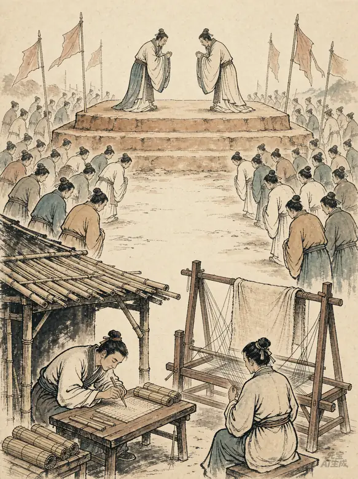

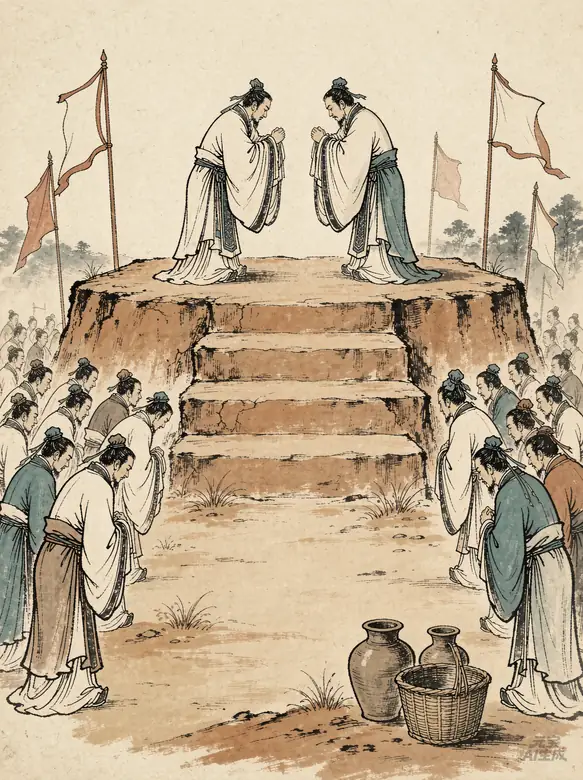

### 字源

- **文**：交错纹理：象形，像交错的纹理；本义为纹理，引申为文字。文是“纹”，字是“孳生”。
- **字**：生育：从宀、子；本义为生育，引申为文字。独体为文，合体为字。
- **衣**：上衣：象形，本义为上身穿的衣裳。衣是上，裳是下。
- **裳**：下裙：本义为下身穿的裙裳。衣裳不是一件东西，是上下两件。
- **让**：推让：此处为让位、推让；古字“讓”有责让之义，两个义项要分开。

### 直译与深解

从这时起，开始制造文字；人们才穿上衣裳。尧把君位推让给舜，舜又让给禹；有虞氏和陶唐氏，就是舜和尧。讨伐有罪的人，安抚受苦的百姓；周武王姬发与商汤，就是这样的人。

这一课从“器”转到“制度”。先有文字，才能记事；先有衣裳，才有礼仪；先有禅让，才有“公天下”的理想；再有征伐，才有“吊民伐罪”的边界。

文明不是一下子来的。它是一层一层长出来的：先能记，再能穿，再能让，再能定是非。

但“让国”不是不要权力。尧舜让国，是把权力放回它该在的位置：天下不是一个人的私产，谁合适，谁就来担。后来“家天下”取代“禅让”，这笔账一直留在中国人心里。

“吊民伐罪”也不是滥杀。它给“伐”立了一条边界：为受苦的人，不为私怨。周发是周武王姬发，殷汤是商汤；这两个名字，把这层边界落到了具体的人身上。

### 对课

- 衣 — 裳
- 推 — 让
- 虞 — 唐
- 周 — 殷
- 发 — 汤

> 二字一顿，四字一联；先读成对，再试一句。

### 生活场景

让孩子写自己的名字，再告诉他：没有文字，这个名字传不到明天。看一件衣服的里面和外面，问：“衣服只是遮身体，还是也在说话？”

### 亲子问

如果班长可以让给更合适的人，你让不让？让了，是不要权力，还是把权力放回它该在的位置？

### 写字

文　衣

### AI形象字 · 全课

全课字墙：始、制、文、字、乃、服、衣、裳、推、位、让、国、有、虞、陶、唐。

AI形象字 · 全课 看这一课：始是女在台，制是刀裁木，文是人胸纹，字是屋下子；乃是绳，服是舟，衣是衣，裳是衣上加尚。推是手推鸟，位是人立，让是言让，国是囗中玉；有是手持月，虞是虎头吴，陶是阜旁匋，唐是口上庚。十六个字，从文字衣裳，走到推位让国；字在变，事也在变。

### 跨典

《道德经》第十七章：“功成事遂，百姓皆谓我自然。”

---

## 第六课　垂拱平章

> 把刀收起来，把位子摆正。

**原文**：吊民伐罪，周发殷汤。坐朝问道，垂拱平章。爱育黎首，臣伏戎羌。遐迩一体，率宾归王。

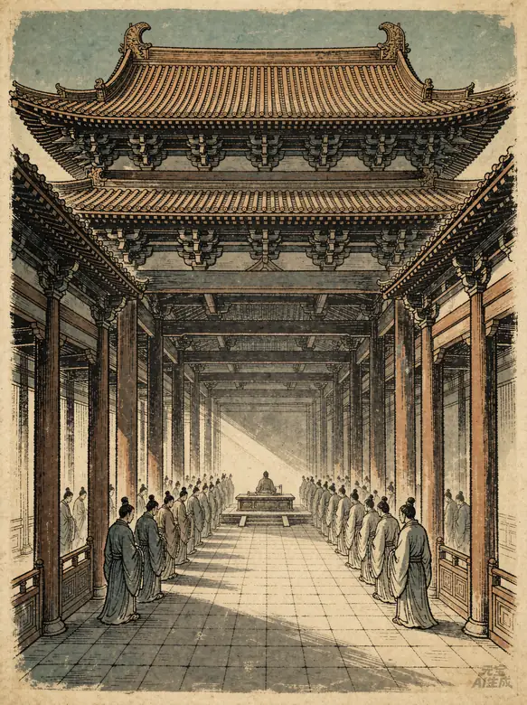

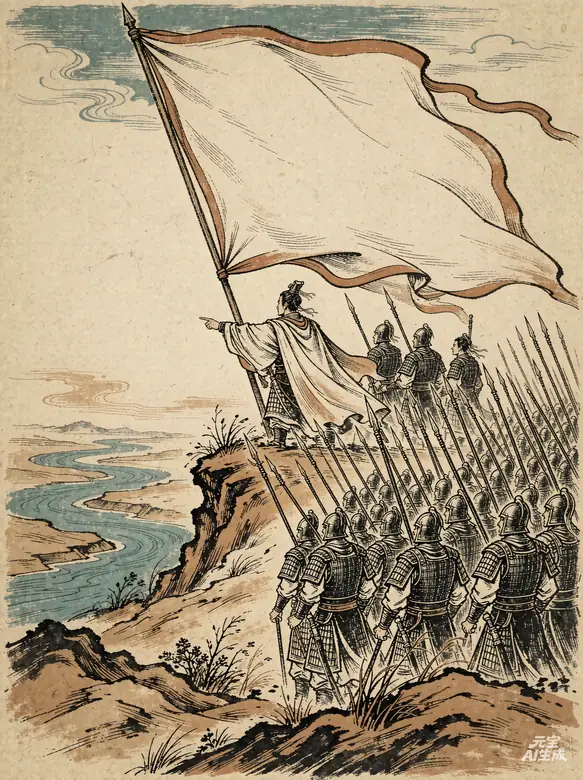

### 字源

- **吊**：吊民，是去问受苦的人；不是吊打。
- **伐**：伐罪，打的是罪，不是打百姓。
- **黎**：黎首，黑发的人，指百姓。
- **遐**：遐迩，就是远和近；一体，是同在一个秩序里。

### 直译与深解

去安抚受苦的百姓，去讨伐有罪的人；周武王发兵，商汤革命，都是这一路。坐朝听政，向臣下问道；垂衣拱手，让政事各得其平，各显其章。

爱护养育百姓，使西戎、羌人归服；远的近的看作一体，四方宾服，归于一王。

“吊民伐罪”四个字，把战争的界线划出来了：为救人而起，不是为杀人而起。周发、殷汤并提，不是说他们两个一样，是说改朝换代也得有个“为民”的名义。名义不是遮羞布，是给后来人立的界。

“垂拱平章”更难。垂拱不是不管，是不用蛮力；平章不是粉饰，是把事理摆平。一个上位者最难学的，是把手放下来，让制度、人才、法度各自运转。

### 对课

- 吊 — 伐
- 民 — 罪
- 遐 — 迩
- 宾 — 王

### 生活场景

和孩子玩“谁该受罚”的游戏：一个人拿了别人的东西，一个人推了人。问：罚哪一个？为什么？

### 亲子问

如果一个人有罪，但他手下有很多无辜的人，伐罪的时候该怎么办？

### 写字

吊　平

### AI形象字 · 全课

全课字墙：32字。吊、民、伐、罪、周、发、殷、汤、坐、朝、问、道、垂、拱、平、章、爱、育、黎、首、臣、伏、戎、羌、遐、迩、一、体、率、宾、归、王。

AI形象字 · 全课 看这一课：吊是慰问受苦的人，民是低头众庶，伐是戈加人身、击的是罪，罪是法网罩住非心；周是田界划得分明，发是弓弦把箭送出去，殷是鼓乐丰盛，汤是水开荡涤。坐是两人对坐土上，朝是月未落、日已升，问是门口开口，道是脚带着头走；垂是枝叶垂下来，拱是两手合抱，平是水面齐平，章是乐声成段。爱是心里放不下，育是养孩子，黎是黑发众民，首是头；臣是低头听命，伏是犬守人身旁，戎是兵器，羌是牧羊人。遐是远，迩是近，一是数之始，体是人的根本；率是牵绳带路，宾是带礼到屋下，归是回到，王是贯通天地人。三十二个字，从伐罪、垂拱，走到近远一体；字在变，事也在变。

### 跨典

《孟子·梁惠王下》：“闻诛一夫纣矣，未闻弑君也。”

---

## 第七课　鸣凤在竹

> 最好的政绩，是连草木都沾到光。

**原文**：鸣凤在竹，白驹食场。化被草木，赖及万方。盖此身发，四大五常。恭惟鞠养，岂敢毁伤。

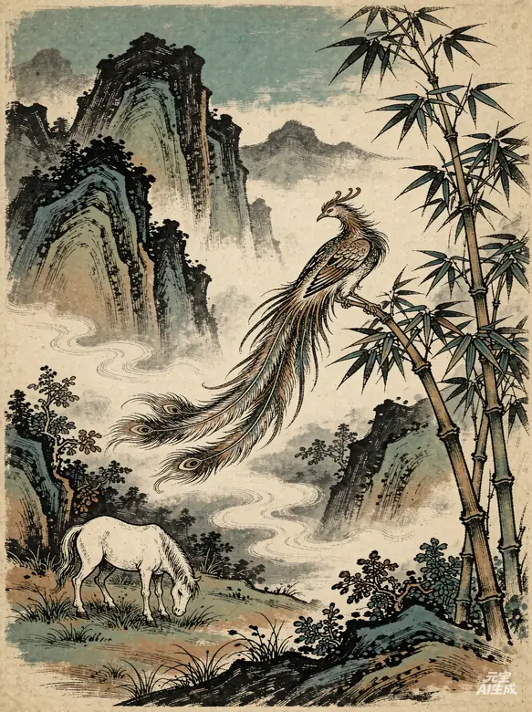

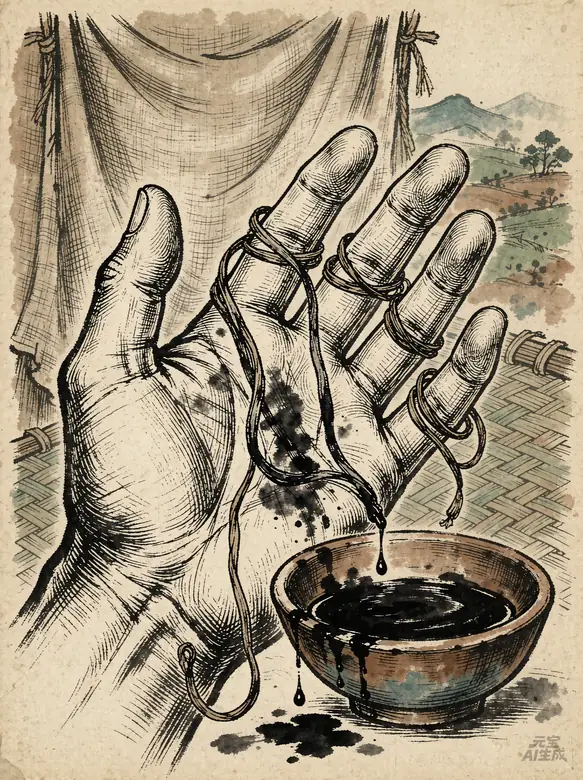

### 字源

- **凤**：凤鸣，是古人心里的好兆头；不是动物园里的鸟。
- **被**：化被草木，教化像光一样盖过去。
- **四大**：古印度说法，指身体由四种元素和合。
- **鞠养**：鞠，是弯下身子抱孩子；养，是喂大。

### 直译与深解

凤在竹间鸣，白马在场上吃草；教化覆盖草木，恩泽到达万方。

这身体、这头发，由四大和合、五常充实；恭敬地想到父母的养育，怎么敢随便毁伤？

祥瑞不是天上掉下来的，是人事做对了，天地显出一点好样子。凤在竹、驹在场，都是“各得其所”：鸟有竹，马有场，人有田。

“化被草木”把政绩说到了细处。看一个地方好不好，不只看宫殿，也看草有没有被踩光、树有没有被砍尽。万方赖及，不是口号，是每一方都找得到依靠。

### 对课

- 鸣 — 食
- 凤 — 驹
- 草 — 方
- 身 — 发

### 生活场景

去公园看一棵被刻满字的树，问孩子：如果树会说话，它会不会疼？

### 亲子问

一个地方很富，但鸟没有地方停，草没有地方长，这算不算好？

### 写字

凤　身

### AI形象字 · 全课

全课字墙：32字。鸣、凤、在、竹、白、驹、食、场、化、被、草、木、赖、及、万、方、盖、此、身、发、四、大、五、常、恭、惟、鞠、养、岂、敢、毁、伤。

AI形象字 · 全课 看这一课：鸣是鸟开口，凤是凤鸟，在是土上，竹是两枝竹；白是日光，驹是小马，食是食器，场是扫过的平地。化是人转身，被是衣加皮，草是草，木是树；赖是依靠，及是手够到，万是蝎形、借为数之多，方是方向。盖是草屋顶，此是脚停在这里，身是人腹，发是头发；四是四横，大是正面人，五是交午，常是巾上加尚。恭是心共，惟是心在，鞠是弯腰抱，养是羊食养大；岂是反问，敢是手执甘，毁是拆坏，伤是人身受损。三十二个字，从凤鸣竹间，走到惜身养德；字在变，事也在变。

### 跨典

《周易·乾卦》：“云从龙，风从虎，圣人作而万物睹。”

---

## 第八课　知过必改

> 把自己的短处，放在阳光下。

**原文**：女慕贞洁，男效才良。知过必改，得能莫忘。罔谈彼短，靡恃己长。信使可覆，器欲难量。

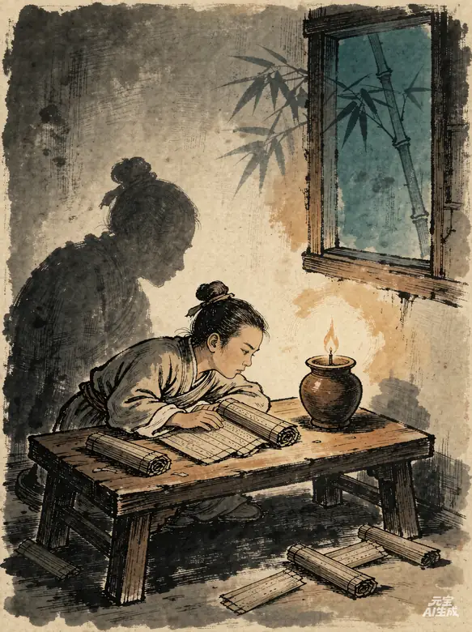

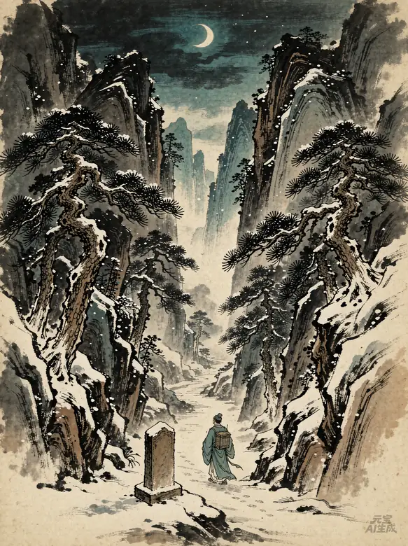

### 字源

- **慕**：慕不是羡慕别人有钱，是心里有一个想成为的样子。
- **效**：效是照着做，不是照着说。
- **罔**：罔谈，就是别谈；不是“网住”。
- **覆**：信使可覆，说过的话要经得起再查一遍。

### 直译与深解

女子向往贞洁，男子学习才良；知道过错一定改，得到能力不要忘。

不要谈别人的短处，不要仗着自己的长处；信用要经得起复核，器量要让人难以测尽。

“女慕贞洁，男效才良”有它的时代分工。今天读，可以把“男女”换成“人人”：无论谁，都要有守住的东西，也要有拿得出手的本事。

“知过必改”难在“必”字。人不是不知道错，是知道了还想拖。拖一次，错就长一寸。“罔谈彼短”也不是让你装看不见，是让你别把别人的短处当谈资。

### 对课

- 贞 — 洁
- 才 — 良
- 短 — 长
- 信 — 器

### 生活场景

孩子打翻水杯，先别急着骂；问：刚才哪一步可以慢一点？下一次怎么做？

### 亲子问

承认错误和改正错误，哪一个更难？

### 写字

改　信

### AI形象字 · 全课

全课字墙：32字。女、慕、贞、洁、男、效、才、良、知、过、必、改、得、能、莫、忘、罔、谈、彼、短、靡、恃、己、长、信、使、可、覆、器、欲、难、量。

AI形象字 · 全课 看这一课：女是跪坐的人，慕是心里学着，贞是守住正，洁是水洗去污；男是田里出力，效是照着做，才是草木初生，良是谷香。知是口说心明，过是走过界限，必是分界，改是手拿鞭；得是手里拿到，能是熊的力量，莫是日落草中，忘是心亡。罔是网，谈是言如火，彼是那边，短是矢之短；靡是散，恃是心仗着，己是绳，长是发长。信是人言，使是人受命，可是口肯，覆是翻过来查；器是四口一犬，欲是欠谷，难是鸟难，量是斗量。三十二个字，从女男修己，走到信器难量；字在变，事也在变。

### 跨典

《论语·子罕》：“过则勿惮改。”

---

## 第九课　景行维贤

> 丝染一次就变，人染一次也会变。

**原文**：墨悲丝染，诗赞羔羊。景行维贤，克念作圣。德建名立，形端表正。空谷传声，虚堂习听。

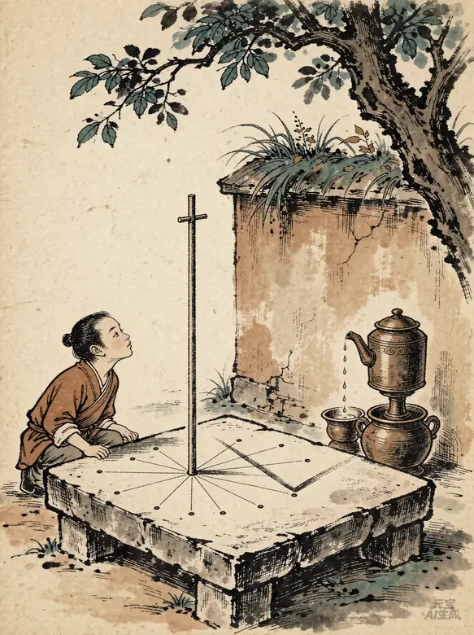

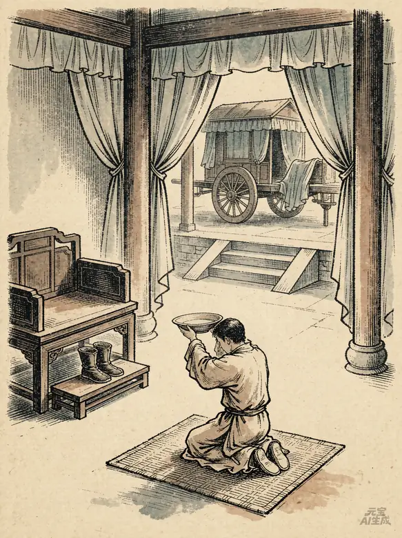

### 字源

- **墨**：墨子见丝被染，悲的是人也会被环境染。
- **羔羊**：赞美节俭、正直的官员。
- **景行**：景行，是光明的大路；维贤，是跟着贤人走。
- **克念**：克，是能；念，是念头。

### 直译与深解

墨子悲叹丝被染，诗经赞美羔羊；走光明的大路，向贤人看齐；能收住念头，就可以学做圣人。

德行立住了，名声才立；形体端正了，影子才正。空谷里喊一声，声音传回来；空堂里听，回声一遍遍。

丝本来是白的，染一次就变。人也是。你天天听什么、看什么、跟谁在一起，慢慢就染成那个颜色。墨子悲的不是丝，是人不知不觉。

“德建名立”不是让你去追名，是告诉你名是德的影子。影子歪，多半是身子歪；名声坏，多半是根上出了事。空谷不偏心，它只把你的声音还给你。

### 对课

- 墨 — 诗
- 贤 — 圣
- 德 — 名
- 声 — 听

### 生活场景

孩子看动画片，一集接一集。问：是你在看，还是屏幕在牵着你走？

### 亲子问

“环境染人”和“自己选环境”，哪一个是你能做主的？

### 写字

念　德

### AI形象字 · 全课

全课字墙：32字。墨、悲、丝、染、诗、赞、羔、羊、景、行、维、贤、克、念、作、圣、德、建、名、立、形、端、表、正、空、谷、传、声、虚、堂、习、听。

AI形象字 · 全课 看这一课：墨是黑土，悲是心非，丝是两束丝，染是水浸木九；诗是言在寺，赞是贝先，羔是小羊，羊是羊。景是日京，行是十字路，维是丝系隹，贤是贝下臣；克是肩任，念是今心，作是人乍，圣是耳口王。德是彳直心，建是廴执笔，名是夕口，立是人站；形是彡画形，端是立耑，表是衣毛，正是止一。空是穴工，谷是水出口，传是人专，声是耳听；虚是虍丘，堂是尚土，习是羽白，听是耳口。三十二个字，从墨悲丝染，走到空谷传声；字在变，事也在变。

### 跨典

《尚书·大禹谟》：“人心惟危，道心惟微，惟精惟一，允执厥中。”

---

## 第十课　寸阴是竞

> 一尺玉，不如一寸光阴。

**原文**：祸因恶积，福缘善庆。尺璧非宝，寸阴是竞。资父事君，曰严与敬。孝当竭力，忠则尽命。

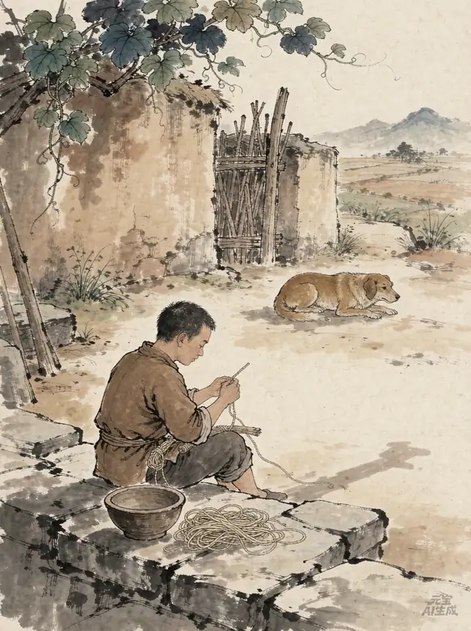

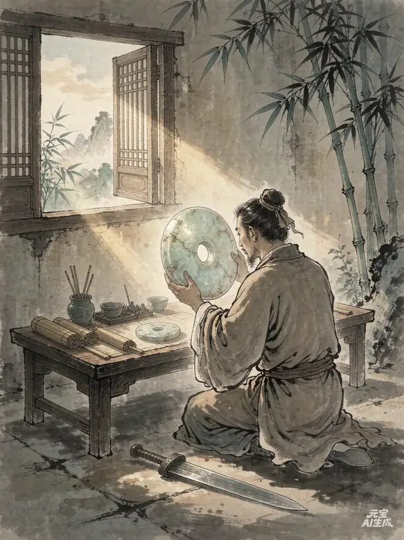

### 字源

- **积**：恶积，是小事一件件堆起来。
- **璧**：尺璧，一尺大的玉；古人眼里的重宝。
- **资**：资父，是靠着父亲的养育。
- **竭**：竭力，是把力气用到尽头。

### 直译与深解

祸患因为恶行积累，福庆因为善行而来；一尺玉璧不算宝，一寸光阴才值得争。

依靠父亲的养育，侍奉君主；讲的是严和敬。孝要竭尽全力，忠要尽到性命。

“祸因恶积”最容易被误读成“报应”。它更像一句常识：坏事不会只做一次，它会长。今天占一点便宜，明天说一句谎，后天就敢做更大的。

“尺璧非宝，寸阴是竞”不是让你焦虑地赶时间，是让你知道什么是真的贵。玉可以再买，时间不能。把时间花在能长人的地方，才叫竞。

### 对课

- 祸 — 福
- 璧 — 阴
- 父 — 君
- 孝 — 忠

### 生活场景

每天睡前问孩子：今天哪一件事，做一次没事，做十次就会变成大问题？

### 亲子问

如果有人用一块很贵的玉，换你一天时间，你换不换？

### 写字

福　敬

### AI形象字 · 全课

全课字墙：32字。祸、因、恶、积、福、缘、善、庆、尺、璧、非、宝、寸、阴、是、竞、资、父、事、君、曰、严、与、敬、孝、当、竭、力、忠、则、尽、命。

AI形象字 · 全课 看这一课：祸是示呙，因是囗大，恶是亚心，积是禾责；福是示畐，缘是丝彖，善是羊言，庆是心鹿。尺是尺，璧是玉辟，非是两翼，宝是宀玉；寸是手下一寸，阴是阜今，是是日正，竞是二兄。资是贝次，父是执斧，事是手持，君是尹口；曰是口出气，严是厂敢，与是手相与，敬是苟攴。孝是老字，当是田尚，竭是立曷，力是力；忠是中心，则是贝刀，尽是皿火，命是口令。三十二个字，从祸福积累，走到寸阴尽力；字在变，事也在变。

### 跨典

《周易·坤卦》：“积善之家，必有余庆；积不善之家，必有余殃。”

---

## 第十一课　如松之盛

> 临深渊，踏薄冰，先把心放稳。

**原文**：临深履薄，夙兴温凊。似兰斯馨，如松之盛。川流不息，渊澄取映。容止若思，言辞安定。

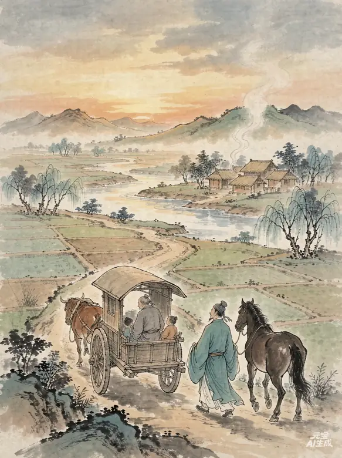

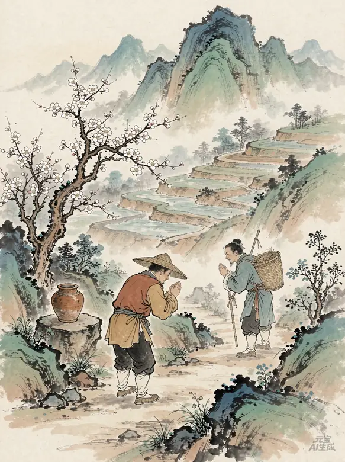

### 字源

- **临**：临深，是站在深潭边上；不是“光临”。
- **夙**：夙兴，是天没亮就起来。
- **馨**：兰香不是浓，是久。
- **澄**：渊澄，是深水清到能照见人。

### 直译与深解

像站在深渊边、踩在薄冰上那样小心；早起侍奉，冬温夏凊。像兰花一样馨香，像松树一样茂盛；像川流一样不停，像深潭一样清澈可照。

容貌举止像在思考，言辞安定不浮。

“临深履薄”不是教人胆小，是教人知道分寸。站在深处，脚就不能乱；踩着薄冰，心就不能飘。敬，是从这种分寸里长出来的。

“似兰斯馨，如松之盛”把德行写成了气味和年轮。兰不争，香得久；松不艳，立得久。川流不息是动，渊澄取映是静；一动一静，才养得住人。

### 对课

- 临 — 履
- 兰 — 松
- 川 — 渊
- 容 — 言

### 生活场景

让孩子端一碗满满的水走几步。问：眼睛看哪里，脚才稳？

### 亲子问

“小心”和“害怕”，差在哪里？

### 写字

敬　松

### AI形象字 · 全课

全课字墙：32字。临、深、履、薄、夙、兴、温、凊、似、兰、斯、馨、如、松、之、盛、川、流、不、息、渊、澄、取、映、容、止、若、思、言、辞、安、定。

AI形象字 · 全课 看这一课：临是俯看，深是水罙，履是足尸，薄是草溥；夙是月未落，兴是四手举，温是水昷，凊是冰青。似是像，兰是草闌，斯是斤其，馨是香；如是女口，松是木公，之是脚，盛是皿成。川是水，流是水㐬，不是花萼，息是自心；渊是水囦，澄是水登，取是手耳，映是日央。容是宀谷，止是脚，若是草右，思是心囟；言是口辛，辞是舌辛，安是宀女，定是宀正。三十二个字，从临深履薄，走到言辞安定；字在变，事也在变。

### 跨典

《诗经·小雅》：“战战兢兢，如临深渊，如履薄冰。”

---

## 第十二课　甘棠之思

> 开始做得漂亮不难，难在收尾。

**原文**：笃初诚美，慎终宜令。荣业所基，籍甚无竟。学优登仕，摄职从政。存以甘棠，去而益咏。

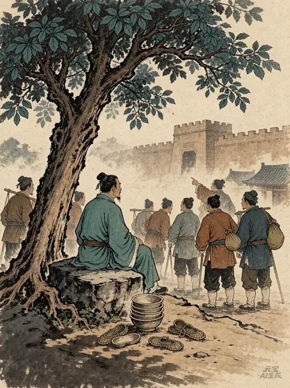

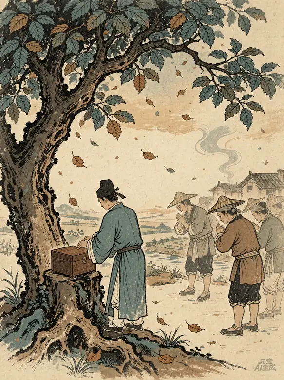

### 字源

- **笃**：笃初，是开头就扎实；不是“笃定”。
- **令**：慎终宜令，收尾也要好。
- **籍**：籍甚，是名声借事而盛。
- **甘棠**：召公曾在甘棠下听政，后人留树思人。

### 直译与深解

开头厚实诚然好，收尾谨慎更该好；荣耀的事业由此奠基，名声因此无穷。

学问优长，出仕任职；留下甘棠，离开后更被歌咏。

“笃初诚美，慎终宜令”是一副对子，也是一句警告。很多人开头热血，结尾潦草；事情坏，往往坏在最后三步。

“存以甘棠”讲的不是一棵树，是一个人走了以后，别人还愿不愿意念他的好。政绩会旧，树会老；人留下的那点厚道，能传。

### 对课

- 初 — 终
- 荣 — 籍
- 学 — 仕
- 存 — 去

### 生活场景

和孩子一起收拾玩具，最后三分钟最难。问：为什么开头容易，收尾难？

### 亲子问

一个人走了以后，别人记住他什么，才算真的“留下”？

### 写字

初　终

### AI形象字 · 全课

全课字墙：32字。笃、初、诚、美、慎、终、宜、令、荣、业、所、基、籍、甚、无、竟、学、优、登、仕、摄、职、从、政、存、以、甘、棠、去、而、益、咏。

AI形象字 · 全课 看这一课：笃是竹马，初是衣刀，诚是言成，美是羊大；慎是心真，终是丝冬，宜是宀且，令是人卩。荣是草木，业是业，所是户斤，基是土其；籍是竹耤，甚是甘匹，无是舞，竟是音儿。学是子爻冖，优是人尤，登是癶豆，仕是人士；摄是手聂，职是耳戠，从是二人，政是正攴。存是子才，以是人耜，甘是口一，棠是木尚；去是大口，而是颊毛，益是皿水，咏是口永。三十二个字，从笃初慎终，走到甘棠遗咏；字在变，事也在变。

### 跨典

《诗经·召南·甘棠》：“蔽芾甘棠，勿剪勿伐，召伯所茇。”

---

## 第十三课　上和下睦

> 礼不是把人分开，是让位置清楚。

**原文**：乐殊贵贱，礼别尊卑。上和下睦，夫唱妇随。外受傅训，入奉母仪。诸姑伯叔，犹子比儿。

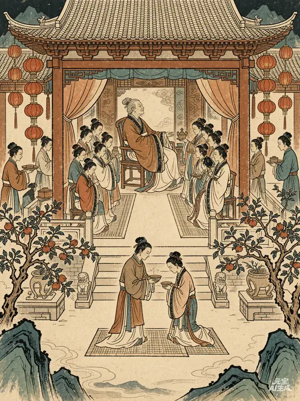

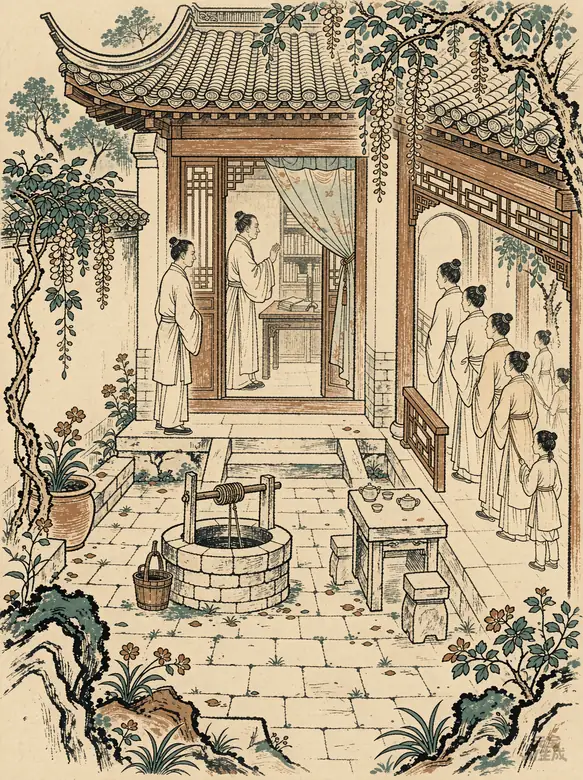

### 字源

- **殊**：乐殊贵贱，是乐也有等级；不是“特殊”。
- **别**：礼别尊卑，是把位置分清。
- **傅**：外受傅训，是在外听老师教。
- **犹子**：犹子比儿，把侄子当儿子一样疼。

### 直译与深解

乐区分贵贱，礼区分尊卑；上下和睦，夫妻相随。在外受老师训导，在家奉母亲仪范；姑姑、伯伯、叔叔，把侄子当儿子一样。

“乐殊贵贱，礼别尊卑”有等级时代的影子。今天不必照搬等级，但可以取它一点：一个家、一个团队，位置要清楚。位置不清，人就容易越界。

“上和下睦”不是上面压下面，是上面肯和，下面才肯睦。夫唱妇随也不是谁服从谁，是两个人在同一个调上。调不一致，唱得再响也散。

### 对课

- 乐 — 礼
- 上 — 下
- 夫 — 妇
- 姑 — 叔

### 生活场景

家里吃饭，谁坐哪里？问孩子：如果客人来了，座位要不要让？

### 亲子问

“有礼貌”是让每个人舒服，还是让某些人显得高？

### 写字

和　睦

### AI形象字 · 全课

全课字墙：32字。乐、殊、贵、贱、礼、别、尊、卑、上、和、下、睦、夫、唱、妇、随、外、受、傅、训、入、奉、母、仪、诸、姑、伯、叔、犹、子、比、儿。

AI形象字 · 全课 看这一课：乐是木丝，殊是歹朱，贵是贝臾，贱是贝戋；礼是示豊，别是刀另，尊是酋寸，卑是手甲。上是上，和是禾口，下是下，睦是目坴；夫是大一，唱是口昌，妇是女帚，随是阜隋。外是夕卜，受是爪冖，傅是人尃，训是言川；入是箭头，奉是手丰，母是女加两点，仪是人义。诸是言者，姑是女古，伯是人白，叔是手小；犹是犬酋，子是子，比是二人，儿是儿。三十二个字，从乐礼尊卑，走到诸姑伯叔；字在变，事也在变。

### 跨典

《论语·学而》：“礼之用，和为贵。”

---

## 第十四课　同气连枝

> 兄弟是一棵树上的枝，朋友是路上的伴。

**原文**：孔怀兄弟，同气连枝。交友投分，切磨箴规。仁慈隐恻，造次弗离。节义廉退，颠沛匪亏。

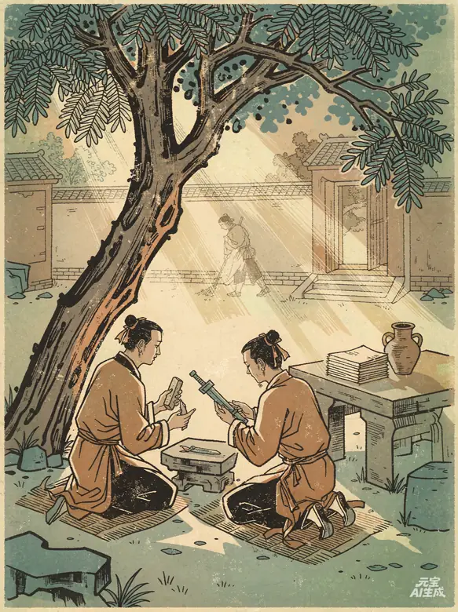

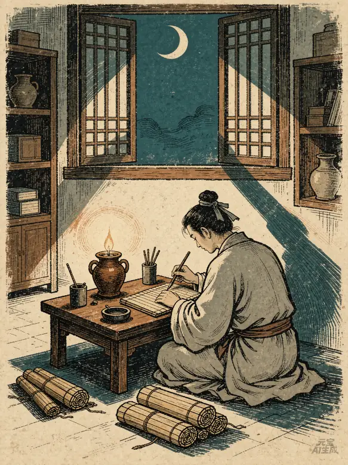

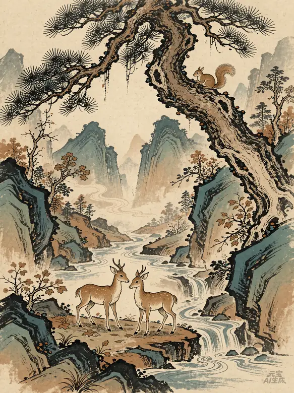

### 字源

- **孔**：孔怀，是很想念；不是“孔子”。
- **投分**：交友投分，是脾气、志趣相投。
- **切磨**：像磨玉一样互相磨。
- **颠沛**：颠沛匪亏，是在最难的时候也不亏德。

### 直译与深解

很想念兄弟，同气连枝；交朋友要投合，互相切磋、规劝。仁慈恻隐，急难时也不离开；节义廉退，困顿中也不亏损。

“同气连枝”不是要求兄弟一模一样，是承认根连在一起。根连，不等于要绑在一起；各自长，互相扶。

“交友投分，切磨箴规”把朋友的标准说清了：不是陪你玩的人，是敢磨你、也肯让你磨的人。只顺着的，不叫朋友。

### 对课

- 兄 — 弟
- 交 — 友
- 仁 — 义
- 造次 — 颠沛

### 生活场景

两个孩子抢一个玩具。问：如果只有一个，怎么让两个都不觉得被丢下？

### 亲子问

朋友做错了，你当面说，还是背后说？哪一种更像朋友？

### 写字

兄　友

### AI形象字 · 全课

全课字墙：32字。孔、怀、兄、弟、同、气、连、枝、交、友、投、分、切、磨、箴、规、仁、慈、隐、恻、造、次、弗、离、节、义、廉、退、颠、沛、匪、亏。

AI形象字 · 全课 看这一课：孔是子乙，怀是心不，兄是口儿，弟是弟；同是凡口，气是气，连是辶车，枝是木支。交是人爻，友是又，投是手殳，分是八刀；切是刀七，磨是石麻，箴是竹咸，规是夫见。仁是人二，慈是心兹，隐是阜急，恻是心则；造是辶告，次是欠二，弗是弓绳，离是隹离。节是竹即，义是羊我，廉是广兼，退是辶艮；颠是页真，沛是水市，匪是匚非，亏是丂。三十二个字，从兄弟同气，走到颠沛不亏；字在变，事也在变。

### 跨典

《论语·颜渊》：“君子以文会友，以友辅仁。”

---

## 第十五课　守真

> 心一乱，神就累；守住真，才不被物牵走。

**原文**：性静情逸，心动神疲。守真志满，逐物意移。坚持雅操，好爵自縻。都邑华夏，东西二京。

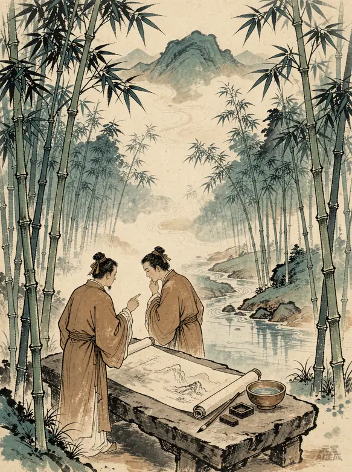

### 字源

- **逸**：情逸，是情绪安闲；不是“逃逸”。
- **真**：守真，是守住自己本来的样子。
- **縻**：好爵自縻，好爵位自己系上来；不是去抢。
- **都邑**：都邑华夏，转到国家的中心。

### 直译与深解

性情安静，情绪就安闲；心一乱动，精神就疲累。守住本真，志向就满；追逐外物，心意就移。坚持雅正的操守，好爵位自然系住你。

华夏的都城，有东西二京。

“性静情逸，心动神疲”是极简的养生句。不是让你没有情绪，是让情绪不要带着心乱跑。心一追，神就耗。

“逐物意移”四个字，今天尤其真。手机一响，心就走；广告一刷，意就移。守真不是躲开世界，是知道自己在追什么。

### 对课

- 性 — 情
- 真 — 物
- 雅 — 爵
- 东 — 西

### 生活场景

孩子玩手机停不下来。问：是你在玩它，还是它在牵你？

### 亲子问

“想要”和“需要”，你能分得清吗？

### 写字

真　静

### AI形象字 · 全课

全课字墙：32字。性、静、情、逸、心、动、神、疲、守、真、志、满、逐、物、意、移、坚、持、雅、操、好、爵、自、縻、都、邑、华、夏、东、西、二、京。

AI形象字 · 全课 看这一课：性是心生命，静是青争，情是心青，逸是兔辶；心是心，动是力重，神是示申，疲是疒皮。守是宀寸，真是目匕八，志是心士，满是水㒼；逐是辶豕，物是牛勿，意是音心，移是禾多。坚是土臤，持是手寺，雅是牙隹，操是手喿；好是女子，爵是爵，自是鼻，縻是丝麻。都是者阝，邑是口巴，华是草化，夏是页夂；东是木日，西是鸟巢，二是二，京是高台。三十二个字，从守真志满，走到东西二京；字在变，事也在变。

### 跨典

《道德经》第十六章：“致虚极，守静笃。”

---

## 第十六课　宫殿盘郁

> 一座城，先看它怎么坐，再看它怎么长。

**原文**：背邙面洛，浮渭据泾。宫殿盘郁，楼观飞惊。图写禽兽，画彩仙灵。丙舍旁启，甲帐对楹。

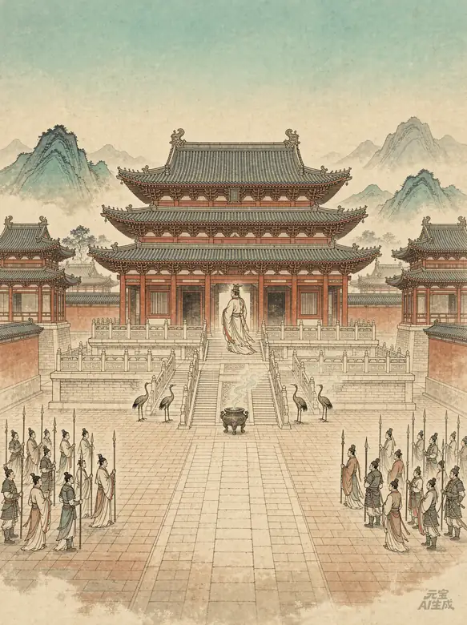

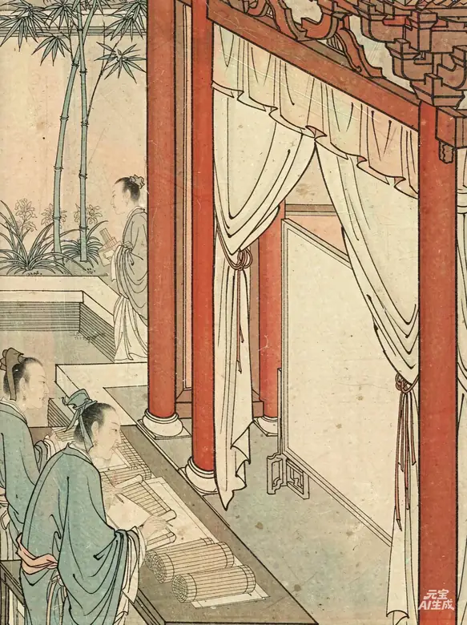

### 字源

- **邙**：洛阳北面的山；背邙，是以山为靠。
- **洛**：面洛，是面朝洛水。
- **盘郁**：宫殿盘郁，是建筑层层叠叠。
- **楹**：甲帐对楹，帐幕对着柱子。

### 直译与深解

背靠北邙，面朝洛水；渭水浮过，泾水据守。宫殿曲折茂盛，楼观高耸惊人；画上禽兽，彩绘仙灵。旁舍从侧边开，甲帐对着楹柱。

“背邙面洛，浮渭据泾”讲的是形势：一座城，靠山面水，才有底气。古人建都，不只看风水，也看粮道、水道、退路。

“宫殿盘郁，楼观飞惊”不是夸豪华，是写秩序。层层叠叠，是等级；飞檐惊人，是威势。孩子看建筑，可以看它想让人产生什么感觉。

### 对课

- 邙 — 洛
- 渭 — 泾
- 宫 — 楼
- 禽 — 仙

### 生活场景

看一张古城地图，让孩子找：山在哪，水在哪，城为什么放在这里？

### 亲子问

一座城很好看，但喝水都困难，这算不算好城？

### 写字

京　宫

### AI形象字 · 全课

全课字墙：32字。背、邙、面、洛、浮、渭、据、泾、宫、殿、盘、郁、楼、观、飞、惊、图、写、禽、兽、画、彩、仙、灵、丙、舍、旁、启、甲、帐、对、楹。

AI形象字 · 全课 看这一课：背是北肉，邙是山亡，面是脸，洛是水各；浮是水孚，渭是水胃，据是手居，泾是水巠。宫是宀吕，殿是殳，盘是皿般，郁是邑有；楼是木娄，观是雚见，飞是鸟飞，惊是心京。图是囗啚，写是宀与，禽是擒，兽是犬嘼；画是田界，彩是采彡，仙是人山，灵是巫火。丙是鱼尾，舍是人舌，旁是方，启是户口；甲是龟甲，帐是巾长，对是又寸，楹是木盈。三十二个字，从背邙面洛，走到甲帐对楹；字在变，事也在变。

### 跨典

《史记·货殖列传》：“昔唐人都河东，殷人都河内，周人都河南。”

---

## 第十七课　广内承明

> 殿宇再高，最后要落到书和人。

**原文**：肆筵设席，鼓瑟吹笙。升阶纳陛，弁转疑星。右通广内，左达承明。既集坟典，亦聚群英。

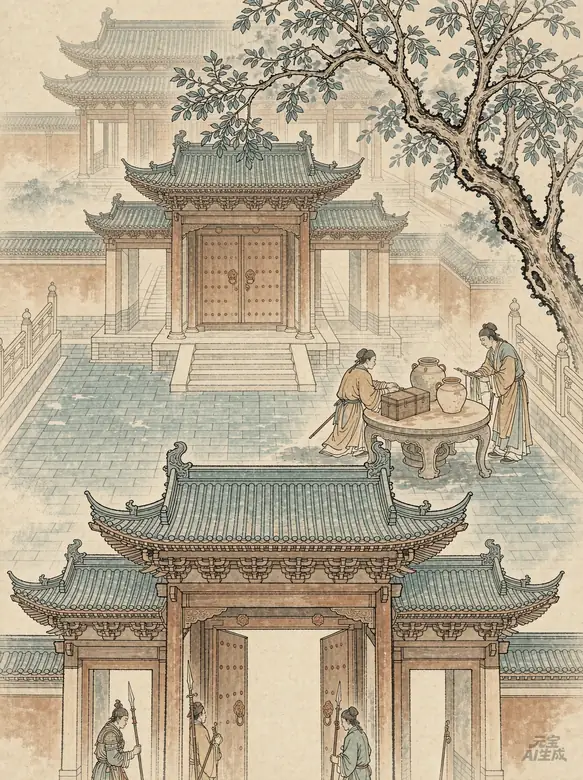

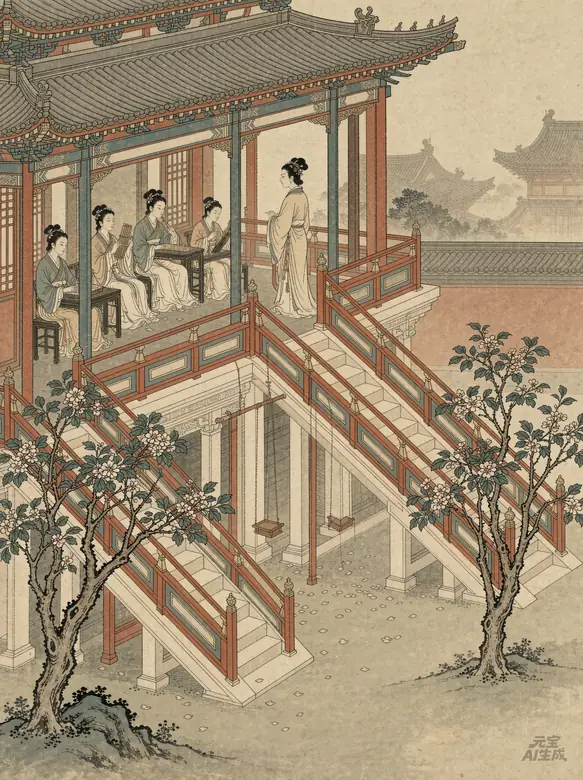

### 字源

- **肆**：肆筵，是把席面铺开。
- **弁**：弁转疑星，礼帽转动像星。
- **坟典**：三坟五典，泛指古书。
- **群英**：群英，是有才的人聚在一处。

### 直译与深解

铺席设宴，鼓瑟吹笙；登上台阶，进入殿陛，礼帽转动像星星。右边通广内殿，左边到承明殿；既收集古书，也聚集群英。

“肆筵设席，鼓瑟吹笙”是礼乐的外场。古人吃饭不是只吃饭，座次、乐次、酒次，都在排位置。

“既集坟典，亦聚群英”把一座宫城的两个宝贝说出来了：书和人。殿宇会旧，书能传；权位会换，人能续。

### 对课

- 筵 — 席
- 瑟 — 笙
- 右 — 左
- 书 — 英

### 生活场景

家庭聚餐，让孩子排座位：谁坐主位，谁坐孩子旁边？为什么？

### 亲子问

一座宫殿里，书重要还是人重要？

### 写字

书　英

### AI形象字 · 全课

全课字墙：32字。肆、筵、设、席、鼓、瑟、吹、笙、升、阶、纳、陛、弁、转、疑、星、右、通、广、内、左、达、承、明、既、集、坟、典、亦、聚、群、英。

AI形象字 · 全课 看这一课：肆是长聿，筵是竹延，设是言殳，席是广巾；鼓是壴支，瑟是琴，吹是口欠，笙是竹生。升是斗，阶是阜皆，纳是丝内，陛是阜毕；弁是帽，转是车专，疑是匕矢，星是日生。右是手口，通是辶甬，广是屋，内是入；左是手工，达是辶大，承是手，明是日月。既是食旡，集是隹木，坟是土文，典是册；亦是腋，聚是取众，群是羊君，英是草央。三十二个字，从肆筵设席，走到群英汇聚；字在变，事也在变。

### 跨典

《论语·先进》：“先进于礼乐，野人也；后进于礼乐，君子也。”

---

## 第十八课　府罗将相

> 门第、车马、冠缨，都是秩序的影子。

**原文**：杜稿钟隶，漆书壁经。府罗将相，路侠槐卿。户封八县，家给千兵。高冠陪辇，驱毂振缨。

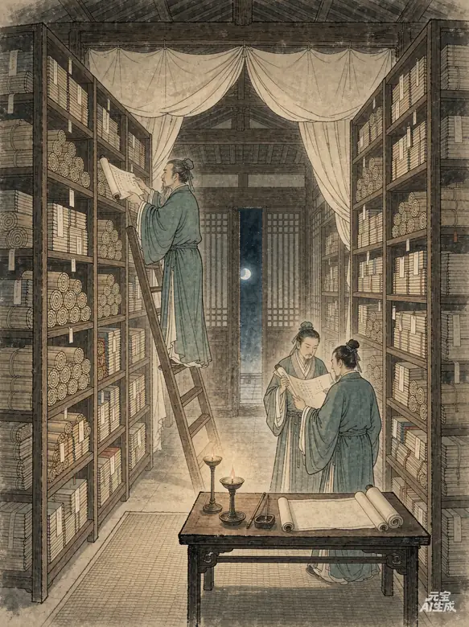

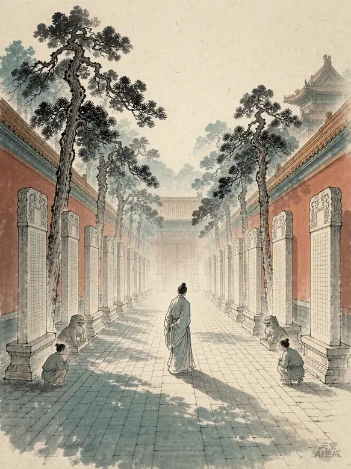

### 字源

- **稿**：杜稿，杜邺的草稿；借指书法。
- **隶**：钟隶，钟繇的隶书。
- **侠**：路侠槐卿，公卿夹道；不是“侠客”。
- **毂**：驱毂，驱车；振缨，冠缨振动。

### 直译与深解

杜邺的草稿、钟繇的隶书，漆写的书、壁中的经；府中罗列将相，路上夹道公卿。封户八县，家给千兵；高冠陪辇，驱车振缨。

“杜稿钟隶，漆书壁经”把文化的载体列出来：纸上的字、漆上的字、墙里的经。载体不同，传的还是同一件事。

“府罗将相，路侠槐卿”是权力排场。排场能看出一个时代重什么：重门第，路上就全是冠缨；重军功，府里就全是兵甲。

### 对课

- 稿 — 隶
- 将 — 相
- 户 — 家
- 冠 — 缨

### 生活场景

看一张古代官员出行的画，问孩子：前面的人为什么多，后面的人为什么少？

### 亲子问

一个人的排场，能说明他的本事吗？

### 写字

相　书

### AI形象字 · 全课

全课字墙：32字。杜、稿、钟、隶、漆、书、壁、经、府、罗、将、相、路、侠、槐、卿、户、封、八、县、家、给、千、兵、高、冠、陪、辇、驱、毂、振、缨。

AI形象字 · 全课 看这一课：杜是木土，稿是禾高，钟是金中，隶是又尾；漆是水桼，书是聿日，壁是辟土，经是丝巠。府是广付，罗是网维，将是寸酱，相是木目；路是足各，侠是人夹，槐是木鬼，卿是两人对食。户是门，封是土寸，八是分，县是悬挂；家是宀豕，给是丝合，千是人，兵是手斤。高是台，冠是冖元寸，陪是阜咅，辇是车夫；驱是马区，毂是车殳，振是手辰，缨是丝婴。三十二个字，从杜稿钟隶，走到高冠陪辇；字在变，事也在变。

### 跨典

《礼记·曲礼》：“列国之大夫，入天子之国曰某士。”

---

## 第十九课　策功勒铭

> 功劳刻在石头上，人却要活在世上。

**原文**：世禄侈富，车驾肥轻。策功茂实，勒碑刻铭。磻溪伊尹，佐时阿衡。奄宅曲阜，微旦孰营。

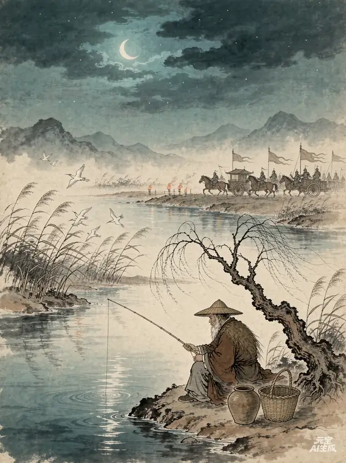

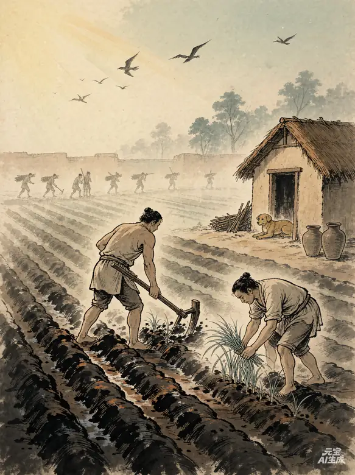

### 字源

- **世禄**：世禄，是家族世代吃俸禄。
- **策功**：策功，把功劳记在册上。
- **磻溪**：借指姜尚。
- **阿衡**：伊尹曾任阿衡，后以指宰相。

### 直译与深解

世代俸禄丰厚，车驾肥轻；把功劳记在册上，刻在碑上。磻溪的姜尚、伊尹，辅佐时世，位居阿衡；曲阜的奄宅，没有周公，谁来经营？

“世禄侈富，车驾肥轻”写的是既得利益者的日子。日子过得太舒服，容易忘事。后面的“策功茂实，勒碑刻铭”像是一句提醒：真要留名，得有功，不是有车。

“磻溪伊尹”把两种出身放在一起：一个在溪边钓鱼，一个出身低微；都能佐时。位置不是天生给你的，是你能不能把事做成。

### 对课

- 世 — 策
- 富 — 功
- 溪 — 尹
- 旦 — 衡

### 生活场景

问孩子：如果一个人家里很有钱，但他什么也不会，别人会怎么看他？

### 亲子问

把名字刻在碑上，和把事做进人心里，哪一个留得久？

### 写字

功　铭

### AI形象字 · 全课

全课字墙：32字。世、禄、侈、富、车、驾、肥、轻、策、功、茂、实、勒、碑、刻、铭、磻、溪、伊、尹、佐、时、阿、衡、奄、宅、曲、阜、微、旦、孰、营。

AI形象字 · 全课 看这一课：世是卅，禄是示录，侈是人多，富是宀畐；车是车，驾是加马，肥是肉巴，轻是车巠。策是竹刺，功是工力，茂是草戊，实是宀贯；勒是革力，碑是石卑，刻是刀亥，铭是金名。磻是石番，溪是水奚，伊是人尹，尹是手执笔；佐是人左，时是日寺，阿是阜可，衡是角大。奄是大电，宅是宀乇，曲是曲，阜是土山；微是彳山几，旦是日一，孰是享丸，营是草宫。三十二个字，从世禄车驾，走到功臣勒铭；字在变，事也在变。

### 跨典

《史记·齐太公世家》：“吕尚盖尝穷困，年老矣，以渔钓奸周西伯。”

---

## 第二十课　匡合

> 霸主不是自己强，是能让弱的不倒。

**原文**：桓公匡合，济弱扶倾。绮回汉惠，说感武丁。俊乂密勿，多士寔宁。晋楚更霸，赵魏困横。

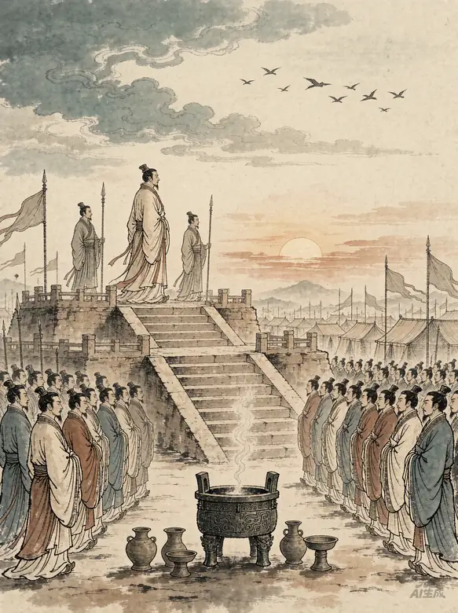

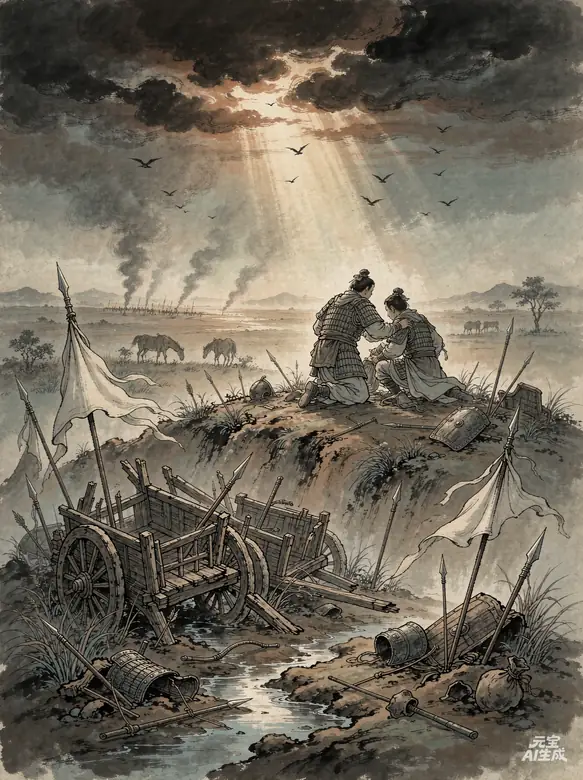

### 字源

- **匡合**：桓公匡合，是齐桓公纠合诸侯。
- **绮**：商山四皓之一，助汉惠帝。
- **说**：商王武丁梦见傅说，得贤相。
- **寔**：寔宁，是实在安宁。

### 直译与深解

齐桓公匡正会合诸侯，济弱扶倾；绮里季使汉惠帝回心，傅说感动武丁。俊才勤勉，多士安宁；晋楚更替称霸，赵魏困于连横。

“桓公匡合，济弱扶倾”把霸主的体面说出来了：不是谁拳头大谁说了算，是谁能让弱的站住。只压不服，不叫霸。

“俊乂密勿，多士寔宁”是治国的底层。人才勤勉，事才安宁。晋楚更霸、赵魏困横，是另一面：位置争来争去，最后困住的是自己。

### 对课

- 匡 — 合
- 济 — 扶
- 晋 — 楚
- 赵 — 魏

### 生活场景

玩积木，让孩子搭一个高塔。问：是中间那块重要，还是旁边扶住的那块重要？

### 亲子问

一个人很强，但没人愿意帮他，他算不算真的强？

### 写字

匡　合

### AI形象字 · 全课

全课字墙：32字。桓、公、匡、合、济、弱、扶、倾、绮、回、汉、惠、说、感、武、丁、俊、乂、密、勿、多、士、寔、宁、晋、楚、更、霸、赵、魏、困、横。

AI形象字 · 全课 看这一课：桓是木亘，公是八厶，匡是匚王，合是亼口；济是水齐，弱是弓羽，扶是手夫，倾是人顷。绮是丝奇，回是囗，汉是水堇，惠是心叀；说是言兑，感是咸心，武是止戈，丁是钉。俊是人夋，乂是刀，密是宀必山，勿是旗；多是夕夕，士是士，寔是宀是，宁是宀丁。晋是日至，楚是林疋，更是攴丙，霸是月雨革；赵是走肖，魏是委鬼，困是囗木，横是木黄。三十二个字，从桓公匡合，走到晋楚更霸；字在变，事也在变。

### 跨典

《论语·宪问》：“桓公九合诸侯，不以兵车，管仲之力也。”

---

## 第二十一课　用军最精

> 打仗最精的，不是杀得多，是算得清。

**原文**：假途灭虢，践土会盟。何遵约法，韩弊烦刑。起翦颇牧，用军最精。宣威沙漠，驰誉丹青。

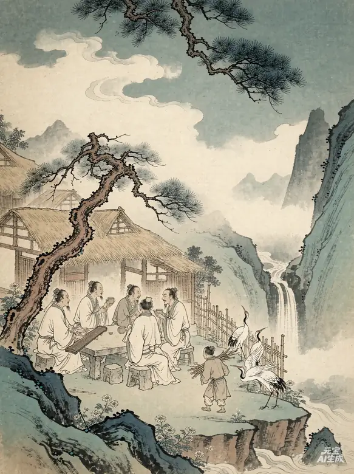

### 字源

- **假途**：假途灭虢，借路去灭虢；借的是路，藏的是刀。
- **践土**：晋文公在践土会盟诸侯。
- **约法**：萧何遵约法，法简而稳。
- **烦刑**：韩非重刑，秦法烦苛。

### 直译与深解

借路灭虢，践土会盟；萧何守简约之法，韩非陷于烦苛之刑。白起、王翦、廉颇、李牧，用兵最精；宣威沙漠，画像留名。

“假途灭虢”是计，也是警告：别人借你一条路，未必只为路过。看事不能只看名义，要看后面的刀。

“何遵约法，韩弊烦刑”是一对：法太简，可能漏；法太繁，一定扰。好法不是写得越多越好，是让人知道什么能做、什么不能做。

### 对课

- 假 — 践
- 约 — 烦
- 起 — 翦
- 威 — 誉

### 生活场景

和孩子走迷宫，问：是走得快重要，还是知道哪条路不能走重要？

### 亲子问

“聪明”用来害人，和用来救人，差在哪里？

### 写字

法　军

### AI形象字 · 全课

全课字墙：32字。假、途、灭、虢、践、土、会、盟、何、遵、约、法、韩、弊、烦、刑、起、翦、颇、牧、用、军、最、精、宣、威、沙、漠、驰、誉、丹、青。

AI形象字 · 全课 看这一课：假是人叚，途是辶余，灭是火戌，虢是虎郭；践是足戋，土是土，会是入云，盟是明皿。何是人可，遵是辶尊，约是丝勺，法是水去；韩是韦倝，弊是敝廾，烦是火页，刑是井刀。起是走己，翦是羽前，颇是皮页，牧是牛攴；用是用，军是车包，最是曰取，精是米青。宣是宀亘，威是女戌，沙是水少，漠是水莫；驰是马也，誉是与言，丹是丹，青是生井。三十二个字，从假途灭虢，走到驰誉丹青；字在变，事也在变。

### 跨典

《史记·孙子吴起列传》：“善战者，因其势而利导之。”

---

## 第二十二课　九州禹迹

> 地图不是纸，是脚走出来的。

**原文**：九州禹迹，百郡秦并。岳宗泰岱，禅主云亭。雁门紫塞，鸡田赤城。昆池碣石，钜野洞庭。

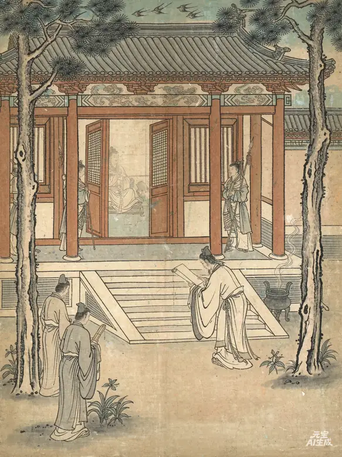

### 字源

- **九州**：禹分九州，后来指中国。
- **泰岱**：五岳之宗。
- **紫塞**：北方边塞，土色紫。
- **碣石**：在今河北昌黎一带。

### 直译与深解

九州留下大禹的足迹，百郡由秦合并；五岳尊泰山，封禅在云亭。雁门、紫塞，鸡田、赤城；昆池、碣石，钜野、洞庭。

“九州禹迹”不是让你背地名，是让你知道：天下是一步一步走出来的。地图上的每一条线，背后都有人蹚过水、翻过山。

“雁门紫塞，鸡田赤城”把边关和塞外放在一起。一个国家的边界，不只是墙，还有守墙的人、走墙外的商队。

### 对课

- 九 — 百
- 岳 — 禅
- 雁 — 鸡
- 昆 — 洞

### 生活场景

找一张中国地图，让孩子用手指从北走到南，问：哪里是山，哪里是水？

### 亲子问

地图上一条线，为什么可能是一条河、一座山，也可能是很多人守过的地方？

### 写字

州　岳

### AI形象字 · 全课

全课字墙：32字。九、州、禹、迹、百、郡、秦、并、岳、宗、泰、岱、禅、主、云、亭、雁、门、紫、塞、鸡、田、赤、城、昆、池、碣、石、钜、野、洞、庭。

AI形象字 · 全课 看这一课：九是臂，州是水中陆地，禹是虫，迹是足亦；百是白，郡是君邑，秦是禾舂，并是两人并。岳是山丘，宗是宀示，泰是大水，岱是代山；禅是示单，主是灯，云是云，亭是高台。雁是厂人隹，门是门，紫是此丝，塞是宀塞；鸡是又鸟，田是田，赤是火土，城是土成。昆是日比，池是水也，碣是石曷，石是山崖；钜是金巨，野是里予，洞是水同，庭是广廷。三十二个字，从九州禹迹，走到钜野洞庭；字在变，事也在变。

### 跨典

《尚书·禹贡》：“禹别九州，随山浚川。”

---

## 第二十三课　治本于农

> 再远的地方，也要回到一碗饭。

**原文**：旷远绵邈，岩岫杳冥。治本于农，务兹稼穑。俶载南亩，我艺黍稷。税熟贡新，劝赏黜陟。

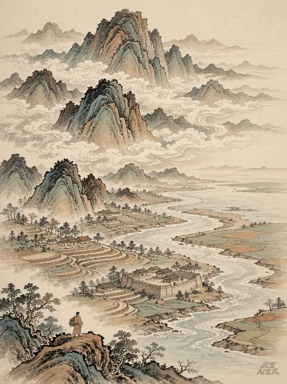

### 字源

- **绵邈**：旷远绵邈，是又空又远。
- **岫**：岩岫，山岩与洞。
- **稼穑**：种曰稼，收曰穑。
- **黜陟**：黜是降，陟是升。

### 直译与深解

旷远绵邈，岩岫幽深；治国的根本在农，要专心种收。开始到南亩，种下黍稷；粮食熟了纳税、进贡新粮，奖赏勤者，升降官吏。

“旷远绵邈，岩岫杳冥”先把人放到大山大水之间。人很小，地很大；正因为大，才要有一个根本。

“治本于农”不是重农轻商，是提醒：再华丽的城，也要有人种粮。税、贡、赏、罚，都从这一碗饭里出。

### 对课

- 旷 — 绵
- 岩 — 岫
- 稼 — 穑
- 黜 — 陟

### 生活场景

吃饭时问孩子：这碗饭从田里到桌上，要经过哪些人的手？

### 亲子问

一个地方没有农民，但有很多商店，它能长久吗？

### 写字

农　稼

### AI形象字 · 全课

全课字墙：32字。旷、远、绵、邈、岩、岫、杳、冥、治、本、于、农、务、兹、稼、穑、俶、载、南、亩、我、艺、黍、稷、税、熟、贡、新、劝、赏、黜、陟。

AI形象字 · 全课 看这一课：旷是日广，远是辶元，绵是丝帛，邈是辶貌；岩是山石，岫是山由，杳是木日，冥是宀日六。治是水台，本是木一，于是气，农是辰田；务是矛力，兹是草丝，稼是禾家，穑是禾啬。俶是人叔，载是车戈，南是南，亩是田每；我是我，艺是草云，黍是禾水，稷是禾畟。税是禾兑，熟是火孰，贡是工贝，新是斤木；劝是力雚，赏是尚贝，黜是黑出，陟是阜步。三十二个字，从旷远岩岫，走到劝赏黜陟；字在变，事也在变。

### 跨典

《管子·牧民》：“仓廪实则知礼节，衣食足则知荣辱。”

---

## 第二十四课　中庸

> 中不是中间，是不偏。

**原文**：孟轲敦素，史鱼秉直。庶几中庸，劳谦谨敕。聆音察理，鉴貌辨色。贻厥嘉猷，勉其祗植。

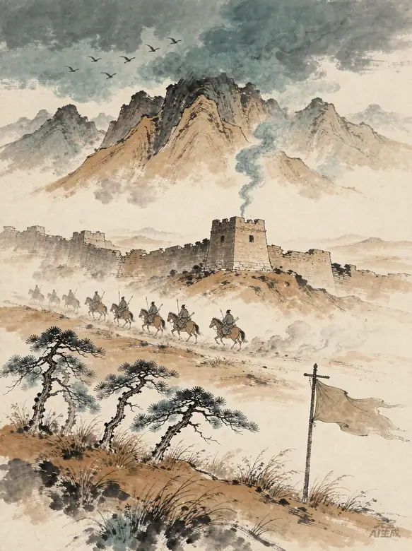

### 字源

- **敦素**：孟轲敦素，守住本来的厚。
- **秉直**：史鱼秉直，直道而行。
- **庶几**：庶几中庸，是希望能接近中道。
- **嘉猷**：贻厥嘉猷，把好主意留给后人。

### 直译与深解

孟轲敦厚朴素，史鱼秉持直道；希望能接近中庸，勤劳谦逊、谨慎自敕。听音以察理，看貌以辨色；留下好谋略，勉励后人扎根。

“孟轲敦素，史鱼秉直”是两种人：一个厚，一个直。厚而不直，容易糊涂；直而不厚，容易伤人。中庸不是各取一半，是让两者都不走极端。

“聆音察理，鉴貌辨色”不是教你猜人心，是教你多听一层。话有话音，事有事理；只听字面，常常听错。

### 对课

- 孟 — 史
- 素 — 直
- 音 — 貌
- 猷 — 植

### 生活场景

孩子和同学吵架，问：你是先听他说完，还是先想他怎么坏？

### 亲子问

“直”和“厚”，能不能同时做到？

### 写字

中　直

### AI形象字 · 全课

全课字墙：32字。孟、轲、敦、素、史、鱼、秉、直、庶、几、中、庸、劳、谦、谨、敕、聆、音、察、理、鉴、貌、辨、色、贻、厥、嘉、猷、勉、其、祗、植。

AI形象字 · 全课 看这一课：孟是子皿，轲是车可，敦是享攴，素是生丝；史是手执笔，鱼是鱼，秉是手禾，直是目十。庶是广火，几是几，中是旗杆，庸是庚用；劳是力荧，谦是言兼，谨是言堇，敕是攴束。聆是耳令，音是言一，察是宀祭，理是玉里；鉴是金监，貌是豸皃，辨是辛刀，色是人巴。贻是贝台，厥是厂欮，嘉是壴加，猷是犬酋；勉是力免，其是箕，祗是示氐，植是木直。三十二个字，从孟轲史鱼，走到嘉猷祗植；字在变，事也在变。

### 跨典

《中庸》：“喜怒哀乐之未发，谓之中；发而皆中节，谓之和。”

---

## 第二十五课　见机

> 知道什么时候走，也是一种本事。

**原文**：省躬讥诫，宠增抗极。殆辱近耻，林皋幸即。两疏见机，解组谁逼。索居闲处，沉默寂寥。

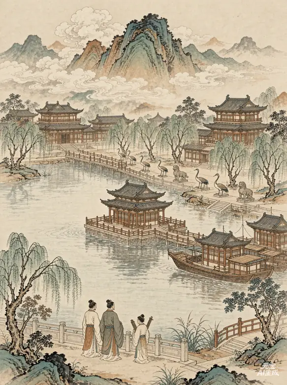

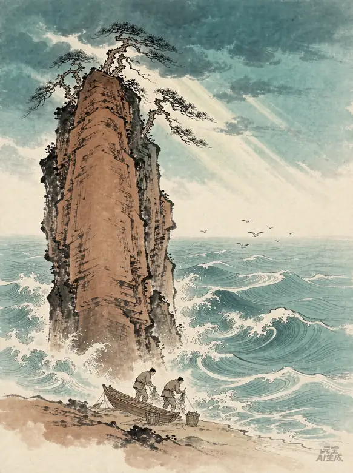

### 字源

- **省躬**：省躬，是回头看自己。
- **抗极**：宠增抗极，恩宠高到不能再高。
- **解组**：解组，是辞官。
- **索居**：索居，是离群独处。

### 直译与深解

反省自身、接受讥诫；恩宠增加，高到极点。接近耻辱时，不如归向山林；两疏见机而退，解下印绶，谁逼他们？独居闲处，沉默寂寥。

“宠增抗极”四个字很冷。宠到极点，下一步往往不是更高，是危险。人在顺的时候，最难看见边界。

“两疏见机”不是消极，是知止。疏广、疏受叔侄在得意时辞官，不是不爱权，是知道权会反噬。退，不一定是输。

### 对课

- 省 — 讥
- 宠 — 辱
- 两 — 解
- 闲 — 寂

### 生活场景

孩子玩游戏，赢了还想再赢。问：什么时候停下来，才算真会玩？

### 亲子问

一个人在最好的时候离开，别人会不会说他傻？

### 写字

省　退

### AI形象字 · 全课

全课字墙：32字。省、躬、讥、诫、宠、增、抗、极、殆、辱、近、耻、林、皋、幸、即、两、疏、见、机、解、组、谁、逼、索、居、闲、处、沉、默、寂、寥。

AI形象字 · 全课 看这一课：省是目少，躬是身弓，讥是言几，诫是言戒；宠是宀龙，增是土曾，抗是手亢，极是木及。殆是歹台，辱是辰寸，近是辶斤，耻是耳心；林是二木，皋是白夲，幸是手枷、转而为幸，即是食卩。两是双，疏是疋梳，见是目儿，机是木几；解是角刀牛，组是丝且，谁是言隹，逼是辶畐。索是丝木，居是尸古，闲是门木，处是夂几；沉是水冘，默是黑犬，寂是宀叔，寥是宀翏。三十二个字，从省躬讥诫，走到索居寂寥；字在变，事也在变。

### 跨典

《道德经》第九章：“功成名遂身退，天之道。”

---

## 第二十六课　散虑

> 把心里的结，放到园子里晒一晒。

**原文**：求古寻论，散虑逍遥。欣奏累遣，戚谢欢招。渠荷的历，园莽抽条。枇杷晚翠，梧桐早凋。

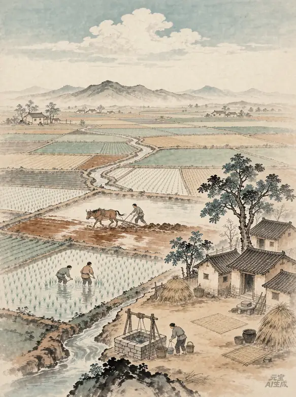

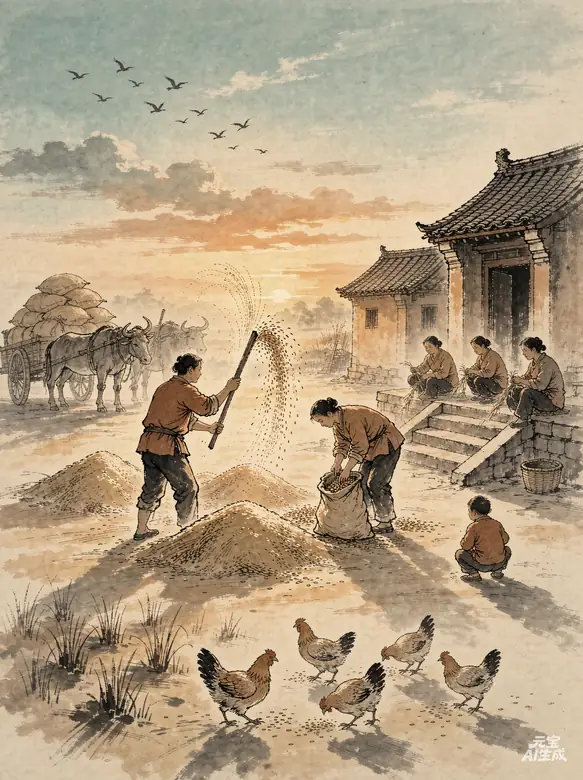

### 字源

- **散虑**：散虑，是把心里的结解开。
- **累遣**：累遣，是把负担送走。
- **的历**：渠荷的历，荷花鲜明。
- **抽条**：园莽抽条，园中草木长枝。

### 直译与深解

求古人、寻论说，排遣忧思，自在逍遥；高兴的事奏上来，牵累送走；忧愁谢去，欢乐招来。池中荷花鲜明，园中草木抽条；枇杷晚翠，梧桐早凋。

“求古寻论”不是躲进古书，是找一个人替你把话说明白。有些结，自己想不通，古人一句话就松了。

“枇杷晚翠，梧桐早凋”是两种命。同样的园子，有的晚，有的早；不是谁好谁坏，是各有各的时。

### 对课

- 求 — 散
- 欣 — 戚
- 荷 — 莽
- 杷 — 桐

### 生活场景

带孩子看一棵落叶树和一棵常绿树。问：为什么它们不一样？

### 亲子问

难过的时候，你会把它藏起来，还是找个地方放下来？

### 写字

散　荷

### AI形象字 · 全课

全课字墙：32字。求、古、寻、论、散、虑、逍、遥、欣、奏、累、遣、戚、谢、欢、招、渠、荷、的、历、园、莽、抽、条、枇、杷、晚、翠、梧、桐、早、凋。

AI形象字 · 全课 看这一课：求是皮衣，古是十口，寻是手寸，论是言仑；散是林肉攴，虑是虍心，逍是辶肖，遥是辶䍃。欣是斤欠，奏是手丰，累是田丝，遣是辶遣；戚是戈尗，谢是言射，欢是雚欠，招是手召。渠是水巨木，荷是草何，的是日勺，历是厂力；园是囗元，莽是草犬，抽是手由，条是木攸。枇是木比，杷是木巴，晚是日免，翠是羽卒；梧是木吾，桐是木同，早是日甲，凋是冫周。三十二个字，从求古寻论，走到枇杷梧凋；字在变，事也在变。

### 跨典

《庄子·刻意》：“虚无恬淡，乃合天德。”

---

## 第二十七课　落叶

> 叶子落了，根还在；书要读，话也要防。

**原文**：陈根委翳，落叶飘摇。游鹍独运，凌摩绛霄。耽读玩市，寓目囊箱。易輶攸畏，属耳垣墙。

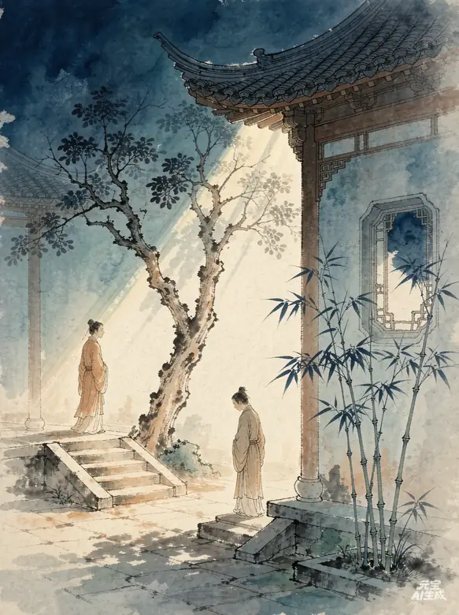

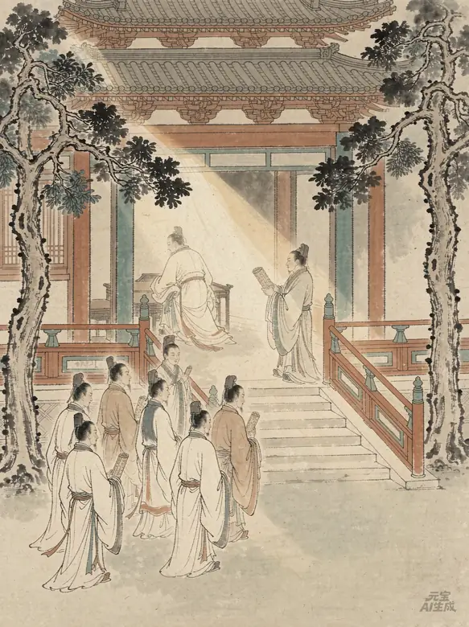

### 字源

- **委翳**：陈根委翳，老根枯了。
- **鹍**：游鹍，高飞的大鸟。
- **耽读**：耽读，是读得入迷。
- **輶**：易輶，轻车易过；借指言语轻易。

### 直译与深解

老根枯萎，落叶飘摇；游鹍独飞，直上红霄。沉溺读书，游于书市，眼观囊箱；轻易的话最可畏，因为墙有耳。

“陈根委翳，落叶飘摇”不是衰败，是季节。根在土里，叶在风里；一个收，一个放。看惯了，就不那么怕老。

“易輶攸畏，属耳垣墙”是一句世故话：轻车容易过，轻话容易传。你以为隔墙没人，墙外可能正有人听。

### 对课

- 陈 — 落
- 根 — 叶
- 读 — 市
- 车 — 墙

### 生活场景

秋天扫落叶，问孩子：叶子落了，树是不是死了？

### 亲子问

一句话说出口，最容易在哪里被传走？

### 写字

叶　读

### AI形象字 · 全课

全课字墙：32字。陈、根、委、翳、落、叶、飘、摇、游、鹍、独、运、凌、摩、绛、霄、耽、读、玩、市、寓、目、囊、箱、易、輶、攸、畏、属、耳、垣、墙。

AI形象字 · 全课 看这一课：陈是阜东，根是木艮，委是禾女，翳是羽殹；落是草洛，叶是口十，飘是票风，摇是手䍃。游是水斿，鹍是昆鸟，独是犬蜀，运是辶云；凌是冫夌，摩是麻手，绛是丝夅，霄是雨肖。耽是耳冘，读是言卖，玩是玉元，市是市场；寓是宀禺，目是眼，囊是袋，箱是竹相。易是晰，輶是车酋，攸是人攵，畏是鬼；属是尸属，耳是耳，垣是土亘，墙是土啬。三十二个字，从陈根落叶，走到属耳垣墙；字在变，事也在变。

### 跨典

《周易·系辞下》：“君子藏器于身，待时而动。”

---

## 第二十八课　适口

> 饭不必贵，合口就好；家不必大，有人就好。

**原文**：具膳餐饭，适口充肠。饱饫烹宰，饥厌糟糠。亲戚故旧，老少异粮。妾御绩纺，侍巾帷房。

### 字源

- **具膳**：具膳，是把饭食备好。
- **饫**：饱饫，是吃得太饱。
- **糟糠**：饥厌糟糠，饿时连糟糠也满足。
- **绩纺**：妾御绩纺，是做纺织。

### 直译与深解

备好饭食，合口充肠；饱时吃烹宰，饿时连糟糠也满足。亲戚故旧，老少各有不同的粮；妾侍纺织，侍奉巾栉在帷房。

“适口充肠”四个字，把吃饭说完了：第一要合口，第二要充饥。山珍海味若不合口，不如一碗热粥。

“饱饫烹宰，饥厌糟糠”是两句对照。饱的时候挑，饿的时候什么都香。人对物的态度，常常取决于自己有没有。

### 对课

- 饱 — 饥
- 烹 — 糟
- 亲 — 故
- 老 — 少

### 生活场景

让孩子吃一口没吃过的菜，问：是味道不好，还是你心里先说不？

### 亲子问

一碗饭，什么时候最好吃？

### 写字

饭　家

### AI形象字 · 全课

全课字墙：32字。具、膳、餐、饭、适、口、充、肠、饱、饫、烹、宰、饥、厌、糟、糠、亲、戚、故、旧、老、少、异、粮、妾、御、绩、纺、侍、巾、帷、房。

AI形象字 · 全课 看这一课：具是鼎手，膳是肉善，餐是食歹，饭是食反；适是辶舌，口是嘴，充是儿育，肠是肉昜。饱是食包，饫是食夭，烹是羊火，宰是宀辛；饥是食几，厌是厂犬肉，糟是米曹，糠是米康。亲是辛木，戚是戈尗，故是古攴，旧是日旧；老是老，少是小，异是田共，粮是米良。妾是女立，御是彳卸，绩是丝责，纺是丝方；侍是人寺，巾是巾，帷是巾隹，房是户方。三十二个字，从具膳餐饭，走到侍巾帷房；字在变，事也在变。

### 跨典

《论语·乡党》：“食不厌精，脍不厌细。”

---

## 第二十九课　纨扇

> 扇子、蜡烛、床，都是日子的形状。

**原文**：纨扇圆絜，银烛炜煌。昼眠夕寐，蓝笋象床。弦歌酒宴，接杯举觞。矫手顿足，悦豫且康。

### 字源

- **纨扇**：纨扇，细绢做的圆扇。
- **絜**：圆絜，是圆而洁。
- **蓝笋**：蓝笋，蓝色竹席。
- **觞**：举觞，是举杯。

### 直译与深解

细绢圆扇，银烛辉煌；白天小睡，夜里安寝，蓝竹席、象牙床。弦歌酒宴，接杯举觞；手舞足蹈，愉悦安康。

“纨扇圆絜，银烛炜煌”写的是富人家的日常。扇要圆，烛要亮，床要贵；这些细节，拼出一个时代的舒服。

“矫手顿足，悦豫且康”是酒酣后的舞。人高兴到一定程度，话不够，就要动。只是别把一时的热闹，当成一辈子的安康。

### 对课

- 扇 — 烛
- 昼 — 夕
- 弦 — 酒
- 手 — 足

### 生活场景

夏天给孩子一把扇子，问：扇子扇的是风，还是心里的急？

### 亲子问

热闹的酒席散了，什么会留下来？

### 写字

扇　乐

### AI形象字 · 全课

全课字墙：32字。纨、扇、圆、絜、银、烛、炜、煌、昼、眠、夕、寐、蓝、笋、象、床、弦、歌、酒、宴、接、杯、举、觞、矫、手、顿、足、悦、豫、且、康。

AI形象字 · 全课 看这一课：纨是丝丸，扇是户羽，圆是囗员，絜是丰丝；银是金艮，烛是火蜀，炜是火韦，煌是火皇。昼是日尺，眠是目民，夕是月，寐是宀爿未；蓝是草监，笋是竹尹，象是象，床是广木。弦是弓玄，歌是哥欠，酒是水酉，宴是宀日女；接是手妾，杯是木不，举是手与，觞是角昜。矫是矢乔，手是手，顿是页屯，足是脚；悦是心兑，豫是予象，且是祖，康是广隶。三十二个字，从纨扇银烛，走到悦豫且康；字在变，事也在变。

### 跨典

《诗经·小雅·鹿鸣》：“我有嘉宾，鼓瑟吹笙。”

---

## 第三十课　祭祀

> 对祖先的敬，是对时间的敬。

**原文**：嫡后嗣续，祭祀烝尝。稽颡再拜，悚惧恐惶。笺牒简要，顾答审详。骸垢想浴，执热愿凉。

### 字源

- **烝尝**：烝是冬祭，尝是秋祭；泛指祭祀。
- **稽颡**：稽颡，额头触地。
- **笺牒**：笺牒，是书信文书。
- **骸垢**：骸垢想浴，身上脏了想洗。

### 直译与深解

嫡系后代延续，四时祭祀；叩头再拜，心怀敬畏。书信文书要简明，回答要审慎周详；身上有垢就想洗，手里热就想凉。

“嫡后嗣续，祭祀烝尝”是宗法社会的骨架。今天不必照搬嫡庶，但可以取它一点：人要知道自己从哪里来，才不容易把眼前当成全部。

“笺牒简要，顾答审详”是两种分寸：写要简，答要详。写得太长，人不想看；答得太略，人不明白。简不是省，详不是啰嗦。

### 对课

- 祭 — 祀
- 稽 — 拜
- 笺 — 答
- 垢 — 热

### 生活场景

清明或冬至，带孩子给祖先牌位鞠一躬。问：我们为什么要记住没见过的人？

### 亲子问

一封短信和一封长信，哪一个更难写？

### 写字

祭　简

### AI形象字 · 全课

全课字墙：32字。嫡、后、嗣、续、祭、祀、烝、尝、稽、颡、再、拜、悚、惧、恐、惶、笺、牒、简、要、顾、答、审、详、骸、垢、想、浴、执、热、愿、凉。

AI形象字 · 全课 看这一课：嫡是女啇，后是人口，嗣是口册司，续是丝卖；祭是肉手示，祀是示巳，烝是火水，尝是尚旨。稽是禾旨，颡是桑页，再是一冉，拜是手手；悚是心束，惧是心具，恐是巩心，惶是心皇。笺是竹戋，牒是片枼，简是竹间，要是西女；顾是页雇，答是竹合，审是宀番，详是言羊。骸是骨亥，垢是土后，想是相心，浴是水谷；执是手丸，热是火执，愿是原心，凉是冫京。三十二个字，从嫡后祭祀，走到执热愿凉；字在变，事也在变。

### 跨典

《礼记·祭统》：“祭者，所以追养继孝也。”

---

## 第三十一课　百工

> 六艺百家，都是人把事做精的样子。

**原文**：驴骡犊特，骇跃超骧。诛斩贼盗，捕获叛亡。布射僚丸，嵇琴阮啸。恬笔伦纸，钧巧任钓。

### 字源

- **犊特**：犊是小牛，特是公牛。
- **超骧**：超骧，是跳得高、跑得快。
- **布**：布射，吕布善射。
- **僚**：宜僚弄丸，善技。

### 直译与深解

驴骡牛犊，惊跃奔腾；诛斩盗贼，捕获叛亡。吕布善射，宜僚弄丸，嵇康弹琴，阮籍长啸；蒙恬制笔，蔡伦造纸，马钧巧思，任公子钓鱼。

“驴骡犊特，骇跃超骧”先写畜生，再写人间的盗贼。一个社会，既要管牲口，也要管人；秩序是从最具体的事开始的。

“布射僚丸，嵇琴阮啸”把四种技艺并列。射、丸、琴、啸，看似不同，都是把一件事练到极处。技没有高低，练到极处都有道。

### 对课

- 驴 — 骡
- 诛 — 捕
- 射 — 琴
- 笔 — 纸

### 生活场景

让孩子学一样小手艺：折纸、系绳、削苹果。问：做到第几次，才觉得顺手？

### 亲子问

一个人会很多样，但每样都只懂一点，算不算有本事？

### 写字

艺　工

### AI形象字 · 全课

全课字墙：32字。驴、骡、犊、特、骇、跃、超、骧、诛、斩、贼、盗、捕、获、叛、亡、布、射、僚、丸、嵇、琴、阮、啸、恬、笔、伦、纸、钧、巧、任、钓。

AI形象字 · 全课 看这一课：驴是马户，骡是马累，犊是牛卖，特是牛寺；骇是马亥，跃是足翟，超是走召，骧是马襄。诛是言朱，斩是车斤，贼是贝戎，盗是水皿；捕是手甫，获是犬蒦，叛是半反，亡是逃。布是巾父，射是身寸，僚是人尞，丸是丸；嵇是山奚，琴是琴，阮是阜元，啸是口肃。恬是心舌，笔是竹毛，伦是人仑，纸是丝氏；钧是金匀，巧是工丂，任是人壬，钓是金勺。三十二个字，从驴骡犊特，走到钧巧任钓；字在变，事也在变。

### 跨典

《周礼·考工记》：“百工之事，皆圣人之作也。”

---

## 第三十二课　利俗

> 有用，还要好看；好看，也要有用。

**原文**：释纷利俗，并皆佳妙。毛施淑姿，工颦妍笑。年矢每催，曦晖朗曜。璇玑悬斡，晦魄环照。

### 字源

- **释纷**：释纷，是把纠纷解开。
- **毛施**：古代美人。
- **年矢**：年矢每催，时间像箭一样催人。
- **璇玑**：璇玑悬斡，北斗运转。

### 直译与深解

解开纠纷、有利风俗，都是佳妙；毛嫱、西施有美姿，皱眉、微笑都好看。岁月如箭催人，日光明亮；北斗运转，月魄循环照临。

“释纷利俗，并皆佳妙”把“有用”放在“好看”前面。能解纷、能利俗，才算真好；只会好看，容易过期。

“年矢每催，曦晖朗曜”是时间的两面：一面催你老，一面每天给你新的太阳。怕老没用，把今天过好才有用。

### 对课

- 释 — 利
- 毛 — 施
- 年 — 日
- 璇 — 晦

### 生活场景

让孩子看一次日出。问：太阳每天一样，还是每天不一样？

### 亲子问

一个人很好看，但什么也不会做，他的好看能留多久？

### 写字

日　月

### AI形象字 · 全课

全课字墙：32字。释、纷、利、俗、并、皆、佳、妙、毛、施、淑、姿、工、颦、妍、笑、年、矢、每、催、曦、晖、朗、曜、璇、玑、悬、斡、晦、魄、环、照。

AI形象字 · 全课 看这一课：释是釆睪，纷是丝分，利是禾刀，俗是人谷；并是两人，皆是比白，佳是人圭，妙是女少。毛是毛，施是方也，淑是水叔，姿是次女；工是工，颦是频卑，妍是女开，笑是竹夭。年是禾人，矢是箭，每是母屮，催是人崔；曦是日羲，晖是日军，朗是良月，曜是日翟。璇是玉旋，玑是玉几，悬是县心，斡是斗倝；晦是日每，魄是白鬼，环是玉不，照是日召火。三十二个字，从释纷利俗，走到晦魄环照；字在变，事也在变。

### 跨典

《周易·系辞上》：“悬象著明，莫大乎日月。”

---

## 第三十三课　指薪修祜

> 火传下去，人才算真的活过。

**原文**：指薪修祜，永绥吉劭。矩步引领，俯仰廊庙。束带矜庄，徘徊瞻眺。孤陋寡闻，愚蒙等诮。谓语助者，焉哉乎也。

### 字源

- **指薪**：指薪，是柴虽烧尽，火种传下去。
- **祜**：修祜，是修福。
- **劭**：吉劭，是吉祥美好。
- **语助**：焉哉乎也，是句末语气词。

### 直译与深解

薪柴烧尽，火种传下去，修福不止；永远安定吉祥。走路合矩，引颈端望，俯仰于廊庙；束带矜庄，徘徊瞻眺。孤陋寡闻，愚蒙的人同样会被讥笑；至于语助词，就是焉、哉、乎、也。

“指薪修祜”是《庄子》里的薪火：柴会烧完，火可以传。人的身体有限，做过的事、教过的人、写下的字，可以接下去。

“孤陋寡闻，愚蒙等诮”是自省，也是给全书收尾。读了一千个字，不等于什么都懂；知道自己寡闻，才还有得学。最后四个语助词，像一口气松开：焉、哉、乎、也，话到这里，留一点余音。

### 对课

- 指 — 修
- 薪 — 祜
- 矩 — 规
- 焉 — 也

### 生活场景

和孩子点一根蜡烛，再用它点另一根。问：第一根烧完了，火还在不在？

### 亲子问

一个人死了，什么东西还能传下去？

### 写字

薪　火

### AI形象字 · 全课

全课字墙：40字。指、薪、修、祜、永、绥、吉、劭、矩、步、引、领、俯、仰、廊、庙、束、带、矜、庄、徘、徊、瞻、眺、孤、陋、寡、闻、愚、蒙、等、诮、谓、语、助、者、焉、哉、乎、也。

AI形象字 · 全课 看这一课：指是手旨，薪是草新，修是人攸彡，祜是示古；永是水长，绥是丝妥，吉是士口，劭是召力。矩是矢巨，步是行止，引是弓丨，领是页令；俯是人府，仰是人卬，廊是广郎，庙是广朝。束是口木，带是巾卅，矜是矛今，庄是草壮；徘是彳非，徊是彳回，瞻是目詹，眺是目兆。孤是子瓜，陋是阜丙，寡是宀页分，闻是门耳；愚是禺心，蒙是草冡，等是竹寺，诮是言肖。谓是言胃，语是言吾，助是且力，者是煮；焉是鸟，哉是口戈，乎是呼，也是蛇。四十个字，从指薪修祜，走到焉哉乎也；字在变，文也在收。

### 跨典

《庄子·养生主》：“指穷于为薪，火传也，不知其尽也。”

## 字源演化 · 甲骨到今字

最后一课不只看字墙，也看字怎么长成今天这样。下面五字有甲骨原形，先看骨；其余三十五字，列本书所见最早字形与演化解读。未见甲骨者，不补造。

### 甲骨五字

| 字 | 甲骨与演化 |
|---|---|
| 永 | 永甲骨作水流长形，金文承之，篆加水旁；永是水长，引申为久远。 |
| 吉 | 吉甲骨作兵器置口上，金文承之；古人以兵器入口为吉，篆从士口，今为吉祥。 |
| 束 | 束甲骨作口木，绳捆木；金文承之，篆从口木，今为约束。 |
| 带 | 带甲骨作巾上有饰，金文承之；篆从巾，今为衣带、携带。 |
| 乎 | 乎甲骨作呼气形，金文承之；篆定乎，今为语气词。 |

### 四十字表

| 字 | 最早字形 | 今字 | 演化解读 |
|---|---|---|---|
| 指 | 金文 | 指 | 指从手从旨，旨是声；甲骨、金文都以手形加旨，篆定左右结构。指是手的指向，也是意的所指。 |
| 薪 | 小篆 | 薪 | 薪从艸从新，新是斧斤砍木；篆作草上斧斤，今为柴薪。柴烧尽，火种还在传。 |
| 修 | 小篆 | 修 | 修从人从攸，攸有长义，加彡为文饰；篆定人行有饰，今为修养、修治。 |
| 祜 | 金文 | 祜 | 祜从示从古，示是祭台，古是声；金文有示旁，今义为福。福不是天降，是人所修。 |
| 永 | 甲骨 | 永 | 永甲骨作水流长形，金文承之，篆加水旁；永是水长，引申为久远。 |
| 绥 | 古文字 | 绥 | 绥从糸从妥，妥是安；古文字以丝系安，篆定绥，今为安绥。 |
| 吉 | 甲骨 | 吉 | 吉甲骨作兵器置口上，金文承之；古人以兵器入口为吉，篆从士口，今为吉祥。 |
| 劭 | 古文字 | 劭 | 劭从力从召，召是声；古文字少见，篆定力旁，今为勉力、美好。 |
| 矩 | 小篆 | 矩 | 矩从矢从巨，巨是木工尺；篆作矢旁巨声，今为规矩。 |
| 步 | 金文 | 步 | 步甲骨作两止相背，金文承之；篆从止少，今为行走。 |
| 引 | 金文 | 引 | 引从弓从丨，弓开而引；金文有弓形，篆定引，今为牵引。 |
| 领 | 小篆 | 领 | 领从页从令，页是头，令是声；篆定领，今为衣领、领受。 |
| 俯 | 古文字 | 俯 | 俯从人从府，府是声；古文字从人低头，篆定俯，今为俯身。 |
| 仰 | 小篆 | 仰 | 仰从人从卬，卬是抬头；篆定仰，今为仰望。 |
| 廊 | 小篆 | 廊 | 廊从广从郎，广是屋，郎是声；篆定廊，今为廊庑。 |
| 庙 | 古文字 | 庙 | 庙从广从朝，广是屋，朝是声；古文字从屋下朝，篆定庙，今为宗庙。 |
| 束 | 甲骨 | 束 | 束甲骨作口木，绳捆木；金文承之，篆从口木，今为约束。 |
| 带 | 甲骨 | 带 | 带甲骨作巾上有饰，金文承之；篆从巾，今为衣带、携带。 |
| 矜 | 小篆 | 矜 | 矜从矛从今，矛是兵器，今是声；篆定矜，今为自持、怜悯。 |
| 庄 | 古文字 | 庄 | 庄从艸从壮，壮是声；古文字从草，篆定庄，今为庄重、村庄。 |
| 徘 | 今字骨架（自创） | 徘 | 徘从彳从非，彳是行走，非是声；古文字未见，今为徘徊。 |
| 徊 | 今字骨架（自创） | 徊 | 徊从彳从回，回是声；古文字未见，今为回旋。 |
| 瞻 | 小篆 | 瞻 | 瞻从目从詹，詹是声；篆定瞻，今为仰视。 |
| 眺 | 小篆 | 眺 | 眺从目从兆，兆是声；篆定眺，今为远望。 |
| 孤 | 小篆 | 孤 | 孤从子从瓜，瓜是声；篆定孤，今为无父、独。 |
| 陋 | 小篆 | 陋 | 陋从阜从丙，阜是土山，丙是声；篆定陋，今为狭小、粗劣。 |
| 寡 | 金文 | 寡 | 寡从宀从页从分，屋下少人；金文有寡形，篆定寡，今为少。 |
| 闻 | 古文字 | 闻 | 闻从门从耳，耳在门内；古文字从耳，篆定闻，今为听见。 |
| 愚 | 古文字 | 愚 | 愚从心从禺，禺是声；古文字从心，篆定愚，今为愚直。 |
| 蒙 | 金文 | 蒙 | 蒙从艸从冡，冡是覆盖；金文承之，篆定蒙，今为蒙昧、蒙受。 |
| 等 | 古文字 | 等 | 等从竹从寺，寺是官署；古文字从竹，篆定等，今为等同。 |
| 诮 | 小篆 | 诮 | 诮从言从肖，肖是声；篆定诮，今为责备。 |
| 谓 | 古文字 | 谓 | 谓从言从胃，胃是声；古文字从言，篆定谓，今为说、称谓。 |
| 语 | 金文 | 语 | 语从言从吾，吾是声；金文承之，篆定语，今为言语。 |
| 助 | 小篆 | 助 | 助从力从且，且是声；篆定助，今为帮助。 |
| 者 | 金文 | 者 | 者甲骨作煮器形，金文承之；篆作者，今为指事、的人。 |
| 焉 | 金文 | 焉 | 焉从鸟，甲骨作鸟形；金文承之，篆定焉，借为语气词。 |
| 哉 | 金文 | 哉 | 哉从口从戈，口是声，戈是形；金文承之，篆定哉，今为感叹。 |
| 乎 | 甲骨 | 乎 | 乎甲骨作呼气形，金文承之；篆定乎，今为语气词。 |
| 也 | 金文 | 也 | 也甲骨作蛇形，金文承之；篆定也，借为语气词。 |

字形来源：课末字墙的单线手绘骨架；甲骨、金文、小篆、古文字未见者，标为“今字骨架（自创）”，不冒充甲骨。

---

## 附录　识字：从甲骨文开始

甲骨文不是图画，是古人把一件事最要紧的骨架留下来。日像太阳，月像月牙，山像三座峰，水像水流；人站着，双手垂下来；子是一个头大的孩子。看一个字，先看它想抓住什么，再看它后来怎么变。

这一册每课末的“AI形象字 · 全课”，是单线手绘字墙：有甲骨、金文、小篆或古文字形者，取其骨架，转成手绘线稿；未见古文字形者，以今字骨架自创。它不是甲骨文复原，是借字的结构做一幅可读的画。附录这一页，才是真甲骨文的来历。两者分开看：一个是古人的字，一个是我们的读法。

> 字形来源：课末字墙以 Chine-Culture Jiaguwen / Jinwen / Xiaozhuan（SIL OFL 1.1；字形源自 ACC 公共领域项目）与汉字源（hanziyuan.net）的古文字形为骨架，转写为单线手绘；未有古文字形者，以今字骨架自创线稿。只作识字取象，不作甲骨文考据。

## 附录二　甲骨文常用字 · 一百二十字（详解）

> 每字一条：字形来源、合集号/著录号、取象解释、书中出现课次。“外”表示课外扩展字。

### 天地

| 字 | 字形来源 | 合集号 | 课次 | 取象与解释 |
|---|---|---|---|---|
| 天 | 甲骨 · 殷契文渊 | 合22453（山博8.43.4） | 01 | 人顶上加一横，指人头顶之上；一横是“上”，人是“顶天立地”的人。 |
| 地 | 甲骨 · 殷契文渊 | 屯4049 | 01 | 土阜之形，先画土堆，后加“也”表延展；大地承载万物，所以从土。 |
| 日 | 甲骨 · 殷契文渊 | 合6057正 | 01 | 画一个圆，中间加一点或一横，像太阳；圆是日轮，点是光。 |
| 月 | 甲骨 · 殷契文渊 | 合137正 | 01 | 画一弯月牙，中间加一竖，像月亮；缺处是月亏，竖是月魄。 |
| 星 | 甲骨 · 殷契文渊 | 合11497正 | 17 | 三个小圆或三点，像夜空里散落的星；星本从“晶”，取光点之形。 |
| 辰 | 甲骨 · 殷契文渊 | 合137反 | 01 | 蚌壳之形，辰本指蚌镰；借为星辰、时辰，是“时”的另一种写法。 |
| 云 | 甲骨 · 殷契文渊 | 合13404 | 02 | 云气回旋，两横上卷，像天上云团；云无定形，所以用回旋线。 |
| 雨 | 甲骨 · 殷契文渊 | 合94正 | 02 | 天幕之下落水点，像雨从天上落下；一横是天，点是雨滴。 |
| 雷 | 甲骨 · 殷契文渊 | 合13409 | 外 | 田形加闪电，像雷声在田野上滚；田是雷声落处，电是雷之形。 |
| 风 | 甲骨 · 殷契文渊 | 合1166甲 | 外 | 借凤鸟之形，凤起飞而风气动；风无形，只能借鸟的翅膀来画。 |
| 山 | 甲骨 · 殷契文渊 | 合6571正 | 外 | 三峰并立，像山脊；中间高，两边低，是山的轮廓。 |
| 水 | 甲骨 · 殷契文渊 | 合10151正 | 03 | 中间一条水流，两旁水点，像河水流动；点是水花，线是水脉。 |
| 火 | 甲骨 · 殷契文渊 | 合11503反 | 04 | 火苗上腾，三点像火星；火无定形，所以画焰与光点。 |
| 土 | 甲骨 · 殷契文渊 | 合6354正 | 21 | 地上土堆，一横为地，一竖为土；土是“地之上、石之下”的那一层。 |
| 石 | 甲骨 · 殷契文渊 | 合33916 | 22 | 山崖下的一块石头；厂是崖，口是石，合起来是石。 |
| 川 | 甲骨 · 殷契文渊 | 合28180 | 11 | 三道水流，像河川；川是流水，也是两岸之间的通道。 |
| 木 | 甲骨 · 殷契文渊 | 合33298,合32806 | 07 | 树干、树枝、树根，像一棵树；上枝下根，中间是干。 |
| 林 | 甲骨 · 殷契文渊 | 合36749 | 25 | 两木并立，像树林；木多成林，所以两木并排。 |
| 森 | 甲骨 · 殷契文渊 | 英1288 | 外 | 三木相叠，像密林；三表示多，木多成森。 |
| 光 | 甲骨 · 殷契文渊 | 合15551 | 03 | 人顶上有火，光从头上照下；火在人上，是“光”的取象。 |

### 时序

| 字 | 字形来源 | 合集号 | 课次 | 取象与解释 |
|---|---|---|---|---|
| 年 | 甲骨 · 殷契文渊 | 合33241 | 32 | 人背禾，禾熟为一年；年是收成，也是时间的一轮。 |
| 岁 | 甲骨 · 殷契文渊 | 合9659 | 02 | 戈形加足，岁本指割禾；借为年岁，是“一岁一枯荣”的岁。 |
| 春 | 甲骨 · 殷契文渊 | 合6560,合6559,合20416 | 外 | 日在下，草木在上，像春日草木生长；春是太阳把草木唤醒。 |
| 夏 | 甲骨 · 殷契文渊 | 合27722 | 15 | 人形加日，像夏日人戴日而作；夏是日长、人劳的时节。 |
| 秋 | 甲骨 · 殷契文渊 | 合33233正 | 02 | 禾与火，像秋收后烧田；秋是禾熟、火燎的时节。 |
| 冬 | 今字骨架（自创） | — | 02 | 绳结两端，像一年终结；冬是岁末，绳结表示“收束”。 |
| 寒 | 甲骨 · 殷契文渊 | 合補9223 | 02 | 屋下冰凌，人蜷其中，像寒冬；寒是屋、冰、人三者合起来的冷。 |
| 暑 | 今字骨架（自创） | — | 02 | 日下有人，像暑天日晒；暑是日在上、人在下，热气蒸腾。 |
| 霜 | 今字骨架（自创） | — | 02 | 雨下相形，像霜结在草木上；霜是雨遇冷，凝成白粒。 |
| 露 | 今字骨架（自创） | — | 02 | 雨下路形，像露水沾地；露是夜里的水，落在草叶上。 |
| 雪 | 甲骨 · 殷契文渊 | 合34039 | 外 | 雨下彗形，像雪片落下；雪是雨凝成花，所以从雨。 |
| 冰 | 今字骨架 | — | 外 | 水旁两点，像水结成冰；冰是水的另一种形态，所以从水。 |
| 晨 | 甲骨 · 殷契文渊 | 合22610 | 外 | 日下辰形，像清早日出；晨是日与时辰相交的那一刻。 |
| 夕 | 甲骨 · 殷契文渊 | 合94正 | 29 | 月缺一半，像傍晚月出；夕是月半见，天色将暗。 |
| 夜 | 甲骨 · 殷契文渊 | 合1075反 | 03 | 人腋下一点，像夜晚人归；夜是日入之后，人回到屋里。 |
| 旦 | 甲骨 · 殷契文渊 | 英1182 | 19 | 日下一横，像太阳刚出地平线；旦是日与地相接。 |
| 早 | 甲骨 · 殷契文渊 | 合6543 | 26 | 日下十形，像清早；早是日初升，尚未到中天。 |
| 晚 | 古文字 | — | 26 | 日旁免形，像日已西斜；晚是日退，天色将晚。 |
| 今 | 甲骨 · 殷契文渊 | 合37 | 外 | 人下有口，像此刻正在说话；今是“当下这一口气”。 |
| 古 | 甲骨 · 殷契文渊 | 合10561 | 26 | 十口相传，像很久以前的事；古是十代口耳相传。 |

### 人身

| 字 | 字形来源 | 合集号 | 课次 | 取象与解释 |
|---|---|---|---|---|
| 人 | 甲骨 · 殷契文渊 | 合43 | 04 | 侧立的人形，一撇一捺像人走路；人是天地间侧身而行的那一个。 |
| 大 | 甲骨 · 殷契文渊 | 合8425 | 07 | 人张开双臂，像大人；大是人的正面，张开双臂表示“大”。 |
| 女 | 甲骨 · 殷契文渊 | 合536 | 08 | 人跪坐，双手交叠，像女子；女是坐姿，表示安处室内。 |
| 子 | 甲骨 · 殷契文渊 | 合2496 | 13 | 头大身小的孩子，像婴孩；子是襁褓中的形状。 |
| 父 | 甲骨 · 殷契文渊 | 合2128 | 10 | 手举斧，像持斧劳作的父亲；父是家里持斧的人。 |
| 母 | 甲骨 · 殷契文渊 | 合19969 | 13 | 女形加两点，像哺育孩子的母亲；两点是乳，表示哺育。 |
| 目 | 甲骨 · 殷契文渊 | 合6195 | 27 | 一只眼睛，中有瞳孔；目是横着的眼，点是瞳。 |
| 耳 | 甲骨 · 殷契文渊 | 合13630 | 27 | 耳朵轮廓，像耳廓；耳是听声音的器官。 |
| 口 | 甲骨 · 殷契文渊 | 合31570 | 28 | 张开的嘴，像人口；口是进出的门。 |
| 手 | 金文 | — | 29 | 五指张开，像一只手；手是劳作、抓取之形。 |
| 足 | 甲骨 | — | 29 | 脚掌与脚趾，像一只脚；足是行走的根。 |
| 心 | 甲骨 · 殷契文渊 | 合11424正,合6 | 15 | 心形，中有血点，像心在跳；心是身中的火。 |
| 首 | 甲骨 · 殷契文渊 | 合6032正 | 06 | 头上有发，像人头；首是人的顶端。 |
| 面 | 甲骨 · 殷契文渊 | 屯2462,合21427,合21428 | 16 | 脸框中有目，像人的脸；面是目所居之处。 |
| 身 | 甲骨 · 殷契文渊 | 合376正（乙4071） | 07 | 人挺腹，像人的身躯；身是人的整体。 |
| 老 | 甲骨 · 殷契文渊 | 合21054,合20293 | 28 | 人头发散，拄杖，像老人；老是年岁在身上的痕迹。 |
| 病 | 今字骨架 | — | 外 | 人卧床上，像生病；病是身体失去平衡。 |
| 死 | 甲骨 · 殷契文渊 | 合22049 | 外 | 人跪于残骨旁，像死亡；死是生命离开身体。 |
| 生 | 甲骨 · 殷契文渊 | 合5165,合5845 | 03 | 地上长草，像草木生出；生是从土里冒出的那一点。 |
| 孕 | 甲骨 · 殷契文渊 | 合21071 | 外 | 人腹中有子，像怀孕；孕是身中有身。 |

### 动物

| 字 | 字形来源 | 合集号 | 课次 | 取象与解释 |
|---|---|---|---|---|
| 牛 | 甲骨 · 殷契文渊 | 合11166（京人3067） | 外 | 牛角向上，像牛头；牛是家畜，角是它的标志。 |
| 羊 | 甲骨 · 殷契文渊 | 合672正 | 09 | 羊角弯曲，像羊头；羊是温顺的家畜。 |
| 马 | 甲骨 · 殷契文渊 | 合584正甲 | 外 | 马头、鬃毛、四足，像马；马是奔跑的牲畜。 |
| 犬 | 甲骨 · 殷契文渊 | 合2585 | 外 | 狗形，像狗；犬是看家、狩猎的伙伴。 |
| 豕 | 甲骨 · 殷契文渊 | 合10281 | 外 | 猪形，像猪；豕是家畜，鼻长、身肥。 |
| 鹿 | 甲骨 · 殷契文渊 | 合10928,合10260 | 外 | 鹿角、鹿头，像鹿；鹿是山林里的兽。 |
| 虎 | 甲骨 · 殷契文渊 | 合3305 | 外 | 虎头、虎口、虎纹，像虎；虎是山中之王。 |
| 象 | 甲骨 · 殷契文渊 | 英322 | 29 | 长鼻、象牙，像象；象是南方的大兽。 |
| 兔 | 甲骨 · 殷契文渊 | 合4616 | 外 | 长耳、短尾，像兔；兔是跳跃的小兽。 |
| 鸟 | 甲骨 · 殷契文渊 | 11498正 | 04 | 鸟头、鸟身、鸟爪，像鸟；鸟是飞禽的总称。 |
| 隹 | 甲骨 · 殷契文渊 | 合93正 | 外 | 短尾鸟，像鸟；隹是鸟的另一个写法。 |
| 鱼 | 甲骨 | — | 24 | 鱼头、鱼身、鱼尾，像鱼；鱼是水中的生灵。 |
| 龟 | 甲骨 · 殷契文渊 | 合18363 | 外 | 龟壳、四足，像龟；龟是长寿的甲虫。 |
| 虫 | 甲骨 · 殷契文渊 | 合22296(乙8718） | 外 | 蛇形，像虫；虫是蛇、虫之类的小生灵。 |
| 蛇 | 今字骨架 | — | 外 | 虫它，像蛇；蛇是长身无足的虫。 |
| 龙 | 甲骨 · 殷契文渊 | 合14153反乙 | 04 | 龙形，像龙；龙是云、雨、雷电的化身。 |
| 凤 | 甲骨 | — | 07 | 凤鸟，像凤；凤是百鸟之王，风从它起。 |
| 燕 | 甲骨 · 殷契文渊 | 合5281 | 外 | 燕形，像燕；燕是春来的候鸟。 |
| 鸡 | 甲骨 · 殷契文渊 | 合29033 | 22 | 鸟奚，像鸡；鸡是家禽，报晓的鸟。 |
| 兽 | 甲骨 | — | 16 | 犬形，像兽；兽是四足的走兽。 |

### 器物

| 字 | 字形来源 | 合集号 | 课次 | 取象与解释 |
|---|---|---|---|---|
| 刀 | 甲骨 · 殷契文渊 | 合32625 | 外 | 刀形，像刀；刀是切削的器。 |
| 戈 | 甲骨 · 殷契文渊 | 合8404 | 外 | 戈形，像戈；戈是钩啄的兵器。 |
| 弓 | 甲骨 · 殷契文渊 | 合7932 | 外 | 弓形，像弓；弓是射箭的器。 |
| 矢 | 甲骨 · 殷契文渊 | 合4787 | 32 | 箭，像箭；矢是弓上的箭。 |
| 斧 | 甲骨 · 殷契文渊 | 合5810,合18456,合3212 | 外 | 斧形，像斧；斧是劈砍的器。 |
| 斤 | 甲骨 · 殷契文渊 | 南坊4.204,合21954(前8.7.1） | 外 | 斧斤，像斤；斤是斧的一种。 |
| 车 | 甲骨 | — | 19 | 车形，像车；车是轮子载人的器。 |
| 舟 | 甲骨 · 殷契文渊 | 合6073 | 外 | 舟形，像舟；舟是水上的器。 |
| 门 | 甲骨 · 殷契文渊 | 合34220 | 22 | 两扇门，像门；门是屋的入口。 |
| 户 | 甲骨 · 殷契文渊 | 屯3185 | 18 | 单扇门，像户；户是半扇门。 |
| 皿 | 甲骨 · 殷契文渊 | 合5742 | 外 | 器皿，像皿；皿是盛物的器。 |
| 鼎 | 甲骨 · 殷契文渊 | 合13404 | 外 | 鼎形，像鼎；鼎是三足两耳的器。 |
| 豆 | 甲骨 · 殷契文渊 | 合29364 | 外 | 高脚盘，像豆；豆是盛肉的礼器。 |
| 壶 | 今字骨架 | — | 外 | 壶形，像壶；壶是盛水的器。 |
| 尊 | 甲骨 · 殷契文渊 | 合14125 | 13 | 酒器，像尊；尊是盛酒的礼器。 |
| 爵 | 甲骨 · 殷契文渊 | 合18572 | 15 | 酒器，像爵；爵是温酒的礼器。 |
| 贝 | 今字骨架 | — | 外 | 贝壳，像贝；贝是古代的货币。 |
| 玉 | 甲骨 · 殷契文渊 | 合3068,合7053正 | 03 | 玉串，像玉；玉是石之美者。 |
| 丝 | 甲骨 | — | 09 | 两束丝，像丝；丝是蚕吐的线。 |
| 帛 | 甲骨 · 殷契文渊 | 合36842(前2.12.4） | 外 | 巾白，像帛；帛是白色的丝织品。 |

### 数字动作

| 字 | 字形来源 | 合集号 | 课次 | 取象与解释 |
|---|---|---|---|---|
| 一 | 甲骨 · 殷契文渊 | 合6834正 | 06 | 一横，像一；一是数的开始。 |
| 二 | 甲骨 · 殷契文渊 | 合17948 | 15 | 二横，像二；二是两横相叠。 |
| 三 | 甲骨 · 殷契文渊 | 合20045 | 外 | 三横，像三；三是三横相叠。 |
| 四 | 甲骨 · 殷契文渊 | 合34210 | 07 | 四横，像四；四是四横相叠。 |
| 五 | 甲骨 · 殷契文渊 | 合137正 | 07 | 交午，像五；五是天地交午之数。 |
| 六 | 甲骨 · 殷契文渊 | 合22713 | 外 | 棚形，像六；六是屋棚之形。 |
| 七 | 甲骨 · 殷契文渊 | 合6057正 | 外 | 切断，像七；七是切物之形。 |
| 八 | 甲骨 · 殷契文渊 | 合8996正 | 18 | 分背，像八；八是分开、相背之形。 |
| 九 | 甲骨 · 殷契文渊 | 合378正 | 22 | 臂形，像九；九是臂肘弯曲之形。 |
| 十 | 甲骨 · 殷契文渊 | 合137正 | 外 | 十字，像十；十是纵横相交。 |
| 上 | 甲骨 · 殷契文渊 | 合809 | 13 | 短横在上，指上；上是“在……之上”。 |
| 下 | 甲骨 · 殷契文渊 | 合809 | 13 | 短横在下，指下；下是“在……之下”。 |
| 中 | 甲骨 · 殷契文渊 | 合10405正 | 24 | 旗杆居中，指中间；中是旗杆立于中央。 |
| 小 | 甲骨 · 殷契文渊 | 合15344 | 外 | 三点，像小；小是细微之形。 |
| 来 | 甲骨 · 殷契文渊 | 合2367 | 02 | 麦穗，像麦来；来是麦子成熟的形状。 |
| 去 | 甲骨 · 殷契文渊 | 合5151,合7312 | 12 | 人离，像去；去是人离开此地。 |
| 出 | 甲骨 · 殷契文渊 | 合6122 | 03 | 脚出坑，像出；出是从坑里走出来。 |
| 入 | 甲骨 · 殷契文渊 | 合7788 | 13 | 箭入，像入；入是进入其中。 |
| 见 | 甲骨 | — | 25 | 目与人，像见；见是目有所见。 |
| 言 | 甲骨 · 殷契文渊 | 合26727 | 11 | 口与舌，像言；言是口舌发出的声音。 |

字形来源：殷契文渊字形库（安阳师范学院）逐字核对，附合集号/著录号；其中一百零二字检出甲骨字形。未检出者标为金文、古文字或今字骨架，不冒充甲骨；EVOBC 仅作六字复核。只作识字取象，不作甲骨文考据。
